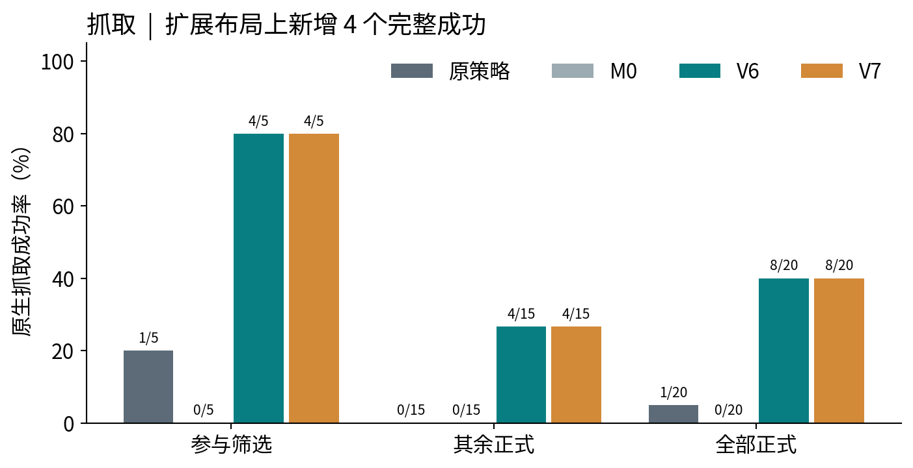

# PhysicalRSI · 从低 Token 执行到技能代码改进

这个项目在 RoboDojo 仿真中复现 PhysicalRSI 的部分任务，并用两组实验分别回答两个问题：执行机器人任务时，语言模型的 Token 花在哪里？任务失败后，让模型阅读执行记录和运动规划证据、修改技能代码，能否让机器人在新布局上完成更多任务？

截至 **2026 年 11 月 22 日**，被测分类 Agent 每回合只做一次高层语言调用，精简技能目录还可进一步减少单次请求的 Token。技能改进方面，System 2 的规划反馈实验在独立布局上未提高完整成功率。后续人工编写的抓取配置在 20 个历史布局上从原策略的 **1/20** 提高到 **8/20**；迁到分类后，C7 在留出布局上取得部分得分，完整成功仍为零。[结果总表](docs/RESULTS.md) · [11 月 16–22 日实验与代码](experiments/task_transfer_20261122/README.md)

## 系统如何工作

| 环节 | 输入与输出 | 对应的测量 |
|---|---|---|
| 高层选择 | 被测分类 Agent 读取任务与技能目录，每回合调用一次语言模型选择技能 | API 请求数、输入与输出 Token、HTTP 耗时 |
| 技能执行 | 本地代码或视觉语言动作模型（VLA）读取观测，驱动多步机器人动作 | 动作轨迹、停止位置、仿真耗时 |
| System 2 改进 | 模型读取父策略与开发回合的失败证据，提交候选代码；部分对照允许查询只读运动规划器 | 候选差异、实际加载的源码哈希、下一轮反馈 |
| 原生验收 | 冻结策略后逐布局执行，用任务自己的终局评分器计分 | 完整成功数、百分制均分、同布局配对差异 |

**为什么 Token 较少？** 在被测分类流程里，高频控制由本地技能承担，动作步数增加不会逐步触发语言请求。另一个因素是单次请求长度。对 120 次合成 API 请求的目录对照中，精简技能目录后，平均输入 Token 降低 67.31%，平均总 Token 降低 66.87%，平均 HTTP 耗时降低 31.65%。这组数衡量提示与请求开销；整回合还包含感知、规划和仿真。GPT-as-Policy 仅用作公开参照，同等任务质量下的跨项目端到端加速比仍待测量。[Token 与耗时证据](docs/EVIDENCE_INDEX.md)

## 研究路线

1. **复现基线。** 用相同任务和布局比较固定代码、Agent 等执行路线，分别记录任务质量与语言开销。
2. **把 System 2 扩展到两个任务。** 在 `general_pickup` 与 `classify_objects` 上对照父策略和模型候选。抓取用来观察单物体动作，分类还要求运输、放置与多物体覆盖。
3. **聚焦 `classify_objects`。** 沿感知、靠近、闭爪、运输、释放和返回逐段检查。固定执行接口后，比较只看执行反馈、额外获得规划证据、以及主动提出规划查询的候选。
4. **冻结后检验泛化，再检验模块迁移。** 在独立布局上检验选出的策略。随后将三模块人工迁入普通抓取，按同布局终局筛选十种配置，再回到分类，检验退臂、重新观察和重抓能否改善整类入筐得分。[研究路线与阶段问题](docs/RESEARCH_ROADMAP.md)

## 仓库导航

| 想了解什么 | 入口 |
|---|---|
| 研究设计、阶段结果和限制 | [研究总览](docs/RESEARCH_OVERVIEW_ZH.md) · [结果总表](docs/RESULTS.md) |
| 上游、执行适配、候选与迁移代码 | [代码导览](docs/CODE_GUIDE.md) · [仓库地图](docs/REPOSITORY_MAP.md) |
| 批次、科研日志与阶段汇报 | [实验目录](experiments/README.md) · [科研日志](research/README.md) · [报告](reports/README.md) |
| 分数复算、依赖与来源 | [复现条件](docs/REPRODUCE.md) · [W47 公开材料与哈希](provenance/w47-20261122.json) · [第三方说明](THIRD_PARTY_NOTICES.md) |

## 实测结果

| 研究问题 | 对照与样本 | 原生结果 |
|---|---|---|
| 能复现哪些能力？ | 历史分类矩阵，2 任务 × 4 路线 × 5 布局 | 固定代码在普通分类与语言分类分别成功 2/5、1/5；历史 Qwen Agent 分别为 1/5、1/5。[历史矩阵](docs/RESULTS.md) |
| 增加规划反馈能否改善分类？ | 两轮代码改进，P 为父策略，A 看执行反馈，B 额外看规划证据 | 开发均分 P 为 0，选出的 A、B 均为 10；冻结后各测 5 个新布局，三组均为 0/5、均分 3。[分组数据](experiments/planning_feedback_20261115/summary.csv) |
| 模型主动查询规划器有效吗？ | 分类一轮开发后，P 与 A 选中同一策略，与 B 在 20 个新布局配对 | 两侧均为 0/20，均分 4.25 与 2.25。B 在 1 个布局得分较高、16 个持平、3 个较低。[逐布局评分](experiments/planning_feedback_20261115/holdout.csv) |
| 哪些成功来自父策略？ | 五任务扩展的插管验收，以及条件对齐后的抓取验收 | 插管候选与父策略均为 4/5、均分 88。抓取三组最终共用同一父策略，修复评分退出后成功 1/20、均分 5。[批次与复用关系](experiments/planning_feedback_20261115/README.md) |
| 首次三模块迁移能改善抓取吗？ | 人工迁移感知、闭爪前控制与持物诊断，在抓取的同一批 20 个历史布局复测 | 历史策略成功 1/20，迁移策略 0/20，均分从 5 降到 0。指定物体抬高超过 10 厘米才算成功。[迁移实现与配对结果](experiments/pickup_transfer_20261119/README.md) |
| 哪些抓取改动提高了成功率？ | 十种预设代码配置各测 8 个布局，V6、V7 各追加 15 个正式布局 | 两版均成功 8/20，其中 4/15 来自本轮未参与筛选的布局；V7 的备用重抓未增加成功。20 个正式布局均有历史诊断记录。[抓取配对表](experiments/task_transfer_20261122/pickup/formal-paired.csv) |
| 抓取改进能迁移到分类吗？ | 首次分类筛选 48 回合均为零分；随后比较闭环控制 C7 与原策略 C0 | 20 个正式布局均分从 0 到 2.25，三例各得 15 分。15 个留出布局均分差 +2.00，两组完整成功均为 0/20。[分类配对表](experiments/task_transfer_20261122/classify/closed_loop/formal-paired.csv) |



11 月 16–22 日共有 **233 个有效原生回合**，抓取 136 个、分类 97 个。既有 M0 结果、复用的父策略以及续跑前的回执按各自实验只计一次。[六条科研记录](research/notes_20261122/W47.md) · [逐回合原生回执](experiments/task_transfer_20261122/episodes.jsonl)

## 离线核验

在仓库根目录运行下列命令。三条命令依次核验本周 233 个原生终局、先前的规划反馈与首次迁移、11 月 2–8 日历史周包，均可离线运行。

```bash
python3 -B tools/verify_w47.py
python3 -B tools/verify_november_results.py
python3 -B tools/verify_weekly_package.py --package reports/research_week_20261102_20261108
```

重新运行原生仿真还需要对应版本的 RoboDojo、权重、布局资产和批次运行环境。仓库保留了可独立复算的评分表，以及能与原始执行核对的源码快照。本研究覆盖有限任务与布局。[上游 PhysicalRSI](https://github.com/PhysicalRSI/PhysicalRSI) · [依赖和复跑条件](docs/REPRODUCE.md)
