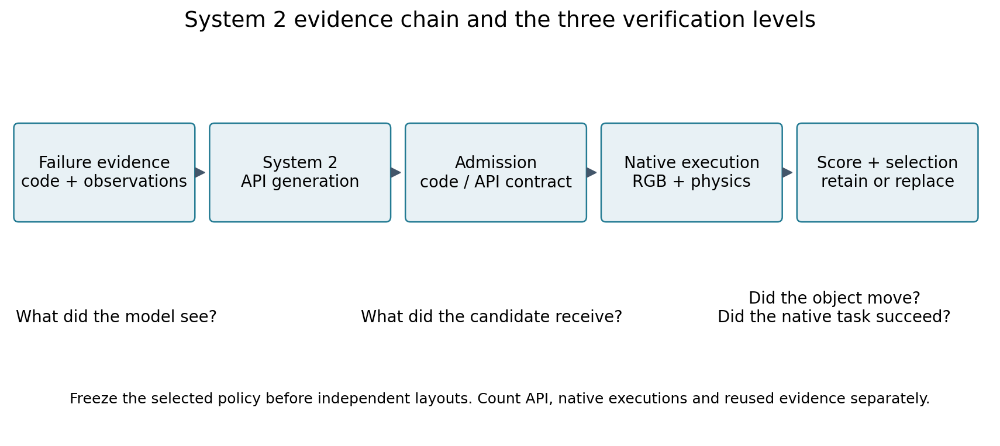

# PhysicalRSI研究总览：从低Token到可验证的技能改进

本页汇总截至2026年11月8日本次实验室取证时刻的完整研究。目标保持为有限范围复现PhysicalRSI，解释Token及耗时差异，并如实分析System 2的正、负结果。项目A（GPT-as-Policy）只提供公开参照，本研究没有运行它。当前页面按问题组织；带日期的旧报告及原始代码保持不变。

[结果总表](RESULTS.md) · [研究路线图](RESEARCH_ROADMAP.md) · [代码导览](CODE_GUIDE.md) · [逐问题证据](EVIDENCE_INDEX.md)

## 1. 研究问题与系统分工

研究围绕三个相互关联、但需要分别验证的问题展开：已有技能能完成多少原生任务；为什么高层语言消耗较少、它是否意味着更快；系统能否依据失败反馈生成真正优于父策略的新技能。

PhysicalRSI的System 1在被测分类配置中，每回合请求一次高层模型，选择技能组合与操作，之后由本地代码或VLA执行多步动作。控制反馈、视觉检测、规划和神经推理仍在本地发生，不能把少语言Token理解为没有闭环计算。

System 2使用开发证据生成代码候选，经过接口准入、匹配原生验证和选择，决定替换或保留父策略。它不是每个控制步重新生成动作，也不等于训练VLA权重。本研究未训练或更新VLA权重。

图中“模型看到的说明”“候选实际收到的返回”“原生任务是否成功”是三个独立核查层。准入通过不证明物理可行，调用正常返回不证明抓持，部分分数不等于整任务成功。

## 2. 先建立有限范围的复现与质量基线

主要原生路线基于PhysicalRSI `90b322a`、RoboDojo、ARX X5、Isaac Sim 5.1与RGB观测，并包含逐批记录的集成适配。冻结上游、历史集成、后续诊断修订不能混成同一源码版本。每批协议、依赖清单、候选与布局哈希才是执行条件，详见[复现说明](REPRODUCE.md)。

正式分类参考矩阵是两任务×四路线×五布局：固定pi05、固定sparse-memory、固定code、Qwen Agent。普通分类成功数依次0/5、0/5、2/5、1/5；语言分类0/5、0/5、1/5、1/5。固定code在这些有限场景里优于神经路线的部分得分，但这不证明在所有任务或官方完整分布上优越。

有限扩展任务另有叠碗1/5、覆盖3/5、插管4/5成功，说明任务差异明显。历史最终保留pi05的独立验收为分类两任务各0/10，属于该固定策略的结果，不是整套Agent成绩。状态保存/恢复验证了已验软件路径，也不证明任务能力提高。

11月2日保持分类任务、布局和目录进行GPT高层替换补测，普通/语言分类分别1/5、2/5成功；两模型对应技能组合与操作10/10一致。图像不逐像素一致且未交错随机重复，因此不能把分数变化单独归因于模型选择更好。[模型替换原件](../experiments/system1_gpt/RESULTS_ZH.md)

## 3. Token的两种来源：调用频率与单次上下文

高层选路与本地动作分离，解释了被测PhysicalRSI配置为何不需要连续产生语言动作段。跨项目公开账目中，历史Qwen配置的A/B平均total比值约888–3,050，去缓存指标约27.59–75.88；GPT补测相应为960–3,209与27.59–79.84。A的缓存输入约97%–98%，模型、推理设置、布局与成功率均不同，所以这些是账目描述，不是等质量节省或费用倍数。

单次上下文则通过PhysicalRSI自身目录消融检验：固定输入API120对照的input下降67.31%、total下降66.87%；它只做接口与用量检查，没有机器人执行。原生目录对照30次尝试、29次进入并完成native，input下降80.20%、total下降79.01%；完整/精简目录成功6/15与5/15，未证明质量不下降。重复运行不增加独立布局数。[目录消融证据](../experiments/fixed_input_api/README.md)

统一账目为total=input+output；去缓存指标=input−cached input+output，缓存是input子集，reasoning若已含output就不再相加。去缓存重算不是关闭缓存的重跑。静态字符/tokenizer估算、CPU代理、真实API usage、原生评分分别报告。

运行时间进一步限制效率解释。历史分类Agent的语言API仅占reset-to-result窗口约7.36%和5.71%；其余还包含控制、渲染、通信、技能推理与未细分开销。三对cold/continuous计时没有观察到连续运行更快，且没有清除所有缓存。项目A完整墙钟未知，不能给出跨项目加速倍数。

## 4. System 2流程已完成，但负结果要求追踪执行

历史Qwen两轮及11月2日GPT补测，都完成候选生成、父/候选匹配验证与选择，最终保留pi05。GPT对应单次生成从26,363降到5,476 Token，但候选依然未带来得分收益。生成成本下降不等于整个机器人任务改善。[历史及补测结果](../experiments/system2_gpt/RESULTS_ZH.md)

失败排查首先区分判断、规划和执行。旧第二轮候选过宽的篮筐XY判定可导致跳过动作；修正后出现动作但仍0分。离线目标设置影响求解可行性，不能直接证明抓取成功。历史异常启动的评分未知，不能将其补成零分。

11月4日对旧候选做CPU诊断与离线验收，再以baseline/augmented各三份生成检验更完整失败反馈；共6次请求、64,674 Token，输入内容与长度同时改变。11月5日六候选加pi05各五历史布局，共35个有效原生回合。增强候选两例各15分都来自layout4，完整成功0；这说明已经出现局部得分，也说明独立泛化尚未建立。该诊断批次没有重跑正式选择器。[批次27–31](../experiments/system2_followup_through_20261105/README.md)

## 5. 受控干预把“多做动作”和“完成任务”分开

11月6–7日批次32–41分别检查抬升guard、撤离目标、轨迹采样、闭爪命令、循环覆盖、运输XY和错误返回。单独去除名义Z判断不够；整项guard旁路能继续执行。waypoint筛选减少预算中止，闭爪命令保持修复命令语义，目标偏移和循环修订增加运输，但对应整任务分数多保持不变。

两个重要历史解释得到修正。批次33的能力说明把后台错误字典当成候选端接口，实际包装却转换成RuntimeError；批次39的旧终止回放遗漏包装层且边界可被候选捕获。因此保留所有分数、请求、源码和旧报告，同时收窄“部署一致的反馈无效”“没有生成恢复分支”等解释。

批次40只修正零动作拒绝返回，真实启用三次候选已有换臂分支；动作推进增加，整任务分数未提高。转换来自本研究适配层，不能归给冻结上游。单周期搬运对照进一步显示，单物体送达代理、正常返回和原生整任务评分是不同事件；不同接口能力的发布技能参照不能当成公平排名。[批次32–43与更正](../experiments/system2_diagnostics_20261106_20261108/README.md)

## 6. 固定执行条件后，重新检验搜索与反馈

11月7日批次42以冻结代码父策略为起点，生成五候选，再做人工运输XY对照、第二轮三份生成与选择后的新布局验收。父策略开发均分3，五个首轮候选全0；1个/5个候选预算都保留父策略。第二轮两份因研究准入规则禁止`nonlocal`被拒，提示词却未告知禁令；它们没有原生分数。唯一准入候选持平父策略，再次保留父策略。

人工目标偏移相对匹配control使开发均分0→3，在五新布局上也为0→3；它是人工单因素干预，不是System 2自主晋升。新布局父策略均分6，属于布局变化后的同一策略，不能称作策略提升。该批60个实际评分执行、8次生成，重复的父策略选择视图共享同一组验收。[冻结选择与独立验收](../reports/research_week_20261102_20261108/06_batch_evidence/42_system2_search_execution_controls/20261107_v1/selection-final.json)

11月8日批次43将试验扩展为分类、抓取两任务；每任务basic/执行反馈各3候选，在五新开发布局上比较，选择冻结后再使用五个新研究布局。分类父策略与六候选全0；抓取父策略3/5成功、均分60，basic候选均分60/60/40，执行反馈40/60/60。所有条件都未满足严格超越规则，保留parent。

独立父策略分类有效4例，0/4成功、均分7.5；抓取有效4例，1/4成功、均分25。各另1例因冻结的轨迹跟踪偏离检查中断，无终态分数。无重试或阈值放宽，不能将null填0，也不能宣称五布局完整验收通过。抓取成功证明部分指定物体可被抬升，不证明稳定搬运或完整分类。[完整本周报告](../reports/research_week_20261102_20261108/01_阶段研究报告.txt)

## 7. 当前边界与接下来仍需回答的问题

当前证据支持低语言交互开销的机制解释，也揭示任务质量受感知、候选逻辑、规划、执行和接口共同限制。已做正式System 2选择，已产生局部得分和抓取成功，但本期仍未选出优于父策略的新技能。长反馈增加输入，生成内容与长度同时变化，不能据此识别单独的反馈语义收益。

11月2–8日近期账目为312个有终态评分执行、44次API请求、562,306 Token；其中11月8日89评分含1准备smoke、另2中断未知。它不是项目全历史总量，各任务、重复布局与不同阶段不构成统一成功率分母。更早的API80/120及历史原生任务仍保留各自独立协议。

尚待回答的重点是：统一后的生成说明、准入与实际包装契约能否稳定保持一致；运输目标与跟踪中断的机制能否被单变量检验；部分抓持能力如何转化为整任务与未见布局收益。具体候选问题和证据缺口列于[路线图](RESEARCH_ROADMAP.md)。这些是未执行问题，不是本次授权启动的新实验。

阅读或复核可从[代码导览](CODE_GUIDE.md)、[证据导航](EVIDENCE_INDEX.md)和[科研日志](../research/README.md)分别进入。原视频、全部观测、权重与安装环境继续保存在实验室；公开仓库不是全盘镜像。本页重写前的历史总览保存在[日期快照](archive/RESEARCH_OVERVIEW_before_20261108.md)，原结果及程序不因展示整理被改写。
