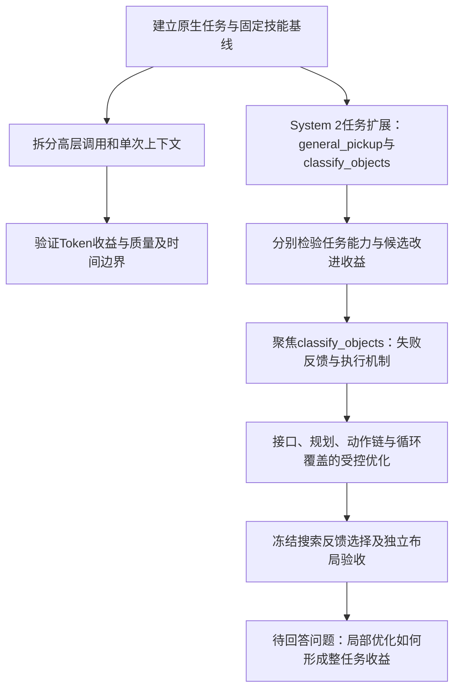

# 研究路线图与当前状态

观察范围为2026-11-08本次服务器取证。研究目标保持“有限范围复现PhysicalRSI，解释Token与耗时差异，检验并解释System 2结果”。项目A只作公开参照。本页按研究问题组织路径：System 2改进机制先扩展到`general_pickup`和`classify_objects`，再聚焦`classify_objects`细化研究。实验真实日期、编号和执行顺序保留在日志与原始批次中；未执行问题不等于已批准或已启动的新实验。

## System 2机制优化：从双任务展开，再细化分类

1. **扩展任务范围**：以`general_pickup`和`classify_objects`共同检验System 2，分别记录父策略、basic候选、执行反馈候选与独立布局结果。抓取成功、完整分类成功和候选超过父策略是不同判断。
2. **聚焦`classify_objects`**：围绕完整分类所需的感知、抓取、运输、放置与多物体循环覆盖，定位候选停在哪个环节；结合生成说明、真实接口返回和原生评分解释失败。
3. **检验机制优化能否产生收益**：使用固定候选的受控干预区分接口与动作执行问题，再用冻结的候选搜索、匹配父策略比较和独立布局验收评估改进。人工修复和自主生成收益分别报告。

双任务结果提供任务层面的参照，分类细化提供机制层面的解释。下表按这条研究逻辑归纳已有证据，批次日期仍可在各入口查证。

## 已完成工作及其作用

| 研究阶段 | 已完成工作 | 这一步改变了什么认识 | 证据入口 |
|---|---|---|---|
| 有限原生复现 | 分类40回合参考矩阵、三项有限扩展、固定策略独立验收、状态恢复 | 技能路线和任务差异很大；软件流程可执行与任务成功分开 | [原生质量总表](RESULTS.md) |
| 语言开销机制 | 静态提示/调度、CPU代理、API80探索与API120对照、原生目录消融 | 调用次数与单次输入是两个变量；低Token不保证同等质量 | [机制与API证据](EVIDENCE_INDEX.md) |
| 时间与模型替换 | 分项计时、三对cold/continuous、11月2日GPT高层与候选补测 | 更短生成不直接转化为整任务加速或System 2得分收益 | [模型补测](../experiments/system1_gpt/RESULTS_ZH.md) |
| System 2双任务扩展 | `general_pickup`/`classify_objects`各两条件三候选；冻结选择、独立布局、停止原因审计 | 抓取存在原生成功，候选仍未超过各自代码父策略；两次验收中断保持未知 | [批次43原件](../reports/research_week_20261102_20261108/06_batch_evidence/43_system2_multitask/) |
| `classify_objects`负结果细化 | 历史两轮、GPT一轮、失败代码与执行轨迹；11月4–5日反馈候选35回合验证 | 零分不是单一原因；已有局部分数但未建立稳定改进 | [批次27–31](../experiments/system2_followup_through_20261105/README.md) |
| 分类接口与动作链受控优化 | guard、轨迹采样、闭爪命令、目标、循环与拒绝包装；最小搬运链 | 动作推进、物体送达和原生任务评分不同；实验适配错误需与上游区分 | [批次32–41](../experiments/system2_diagnostics_20261106_20261108/README.md) |
| 分类搜索与独立布局验收 | 5候选池、人工XY对照、第二轮生成、三种唯一策略新布局验收 | 当前有限池均未超过父策略；未准入候选没有物理分数 | [批次42原件](../reports/research_week_20261102_20261108/06_batch_evidence/42_system2_search_execution_controls/) |

已有的反馈增强、契约诊断和新布局验收不能继续列为“完全未做”的计划。后续问题需要使用这些已完成结果重新定义，而不是重复此前流程或重启旧目录。

## 当前仍未解决的问题

| 问题 | 已有证据 | 若将来开展研究，需要补足什么 |
|---|---|---|
| 模型说明、候选返回和准入是否始终一致 | 历史能力说明/包装不一致已更正；第二轮发生未告知语法禁令 | 同源接口定义与真实包装、成功/拒绝/异常/超时/准入路径的前置核对 |
| 运输规划拒绝由哪些因素决定 | 目标偏移改变局部可行性；11月8日增强分类候选集中停在第四个运输请求 | 固定候选、持物状态与评分，预先定义可归因干预，保留规划和物理状态边界 |
| 跟踪偏离为什么触发 | 两次独立验收定位到观测关节与下一waypoint差值检查 | 核对观测、规划、执行时序及实际响应，不能直接放宽阈值或反复重试到成功 |
| 局部抓取如何转成整任务稳定收益 | 抓取成功和单物体送达存在，分类覆盖与稳定放置仍受限 | 匹配父策略与候选，统一任务、布局和预算，并保持开发选择与验收分离 |
| 反馈内容与搜索次数各有什么贡献 | 长反馈同时改变信息量和长度；第二轮也增加搜索机会 | 预先区分生成重复数、布局数、反馈内容和长度，不能从混合变化推单因素因果 |
| 同等质量下能否节约总体资源 | 语言用量较低，API仅占部分执行窗口 | 对齐质量与计时边界；现有跨项目完整墙钟不足以提供加速倍数 |

以上仅为证据驱动的待研究问题。当前任务完成的是记录、整理、复算与公开材料维护；没有新增候选、训练、原生回合或自动重试。

## 怎样继续维护这条路线

新科学工作发生后，按现有模板追加实验编号、假设、实际改动、原始命令/版本/布局、指标、失败和下一步，再把影响主线判断的结果写入讨论及时间线。历史草案与旧PPT保留日期；最新认识维护在[研究总览](RESEARCH_OVERVIEW_ZH.md)和[结果总表](RESULTS.md)，不靠堆叠日期补丁替代当前叙述。

科研状态以[当前档案入口](../research/README.md)为准，独立核查路径见[代码导览](CODE_GUIDE.md)和[复现说明](REPRODUCE.md)。
