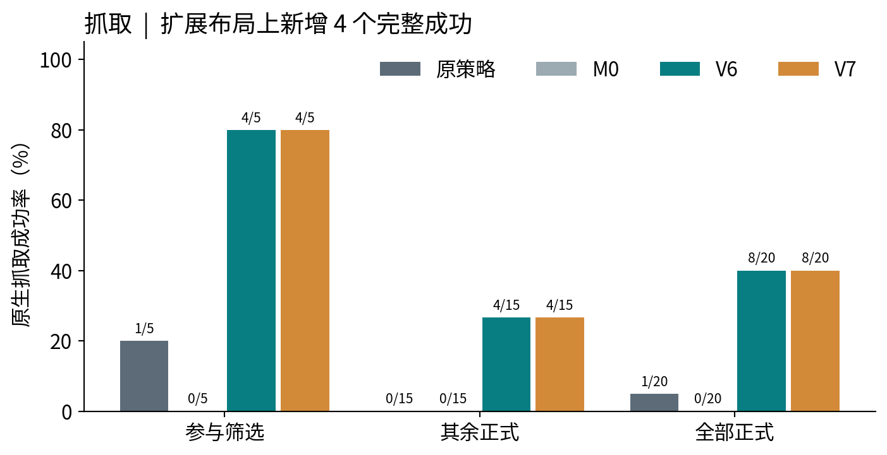
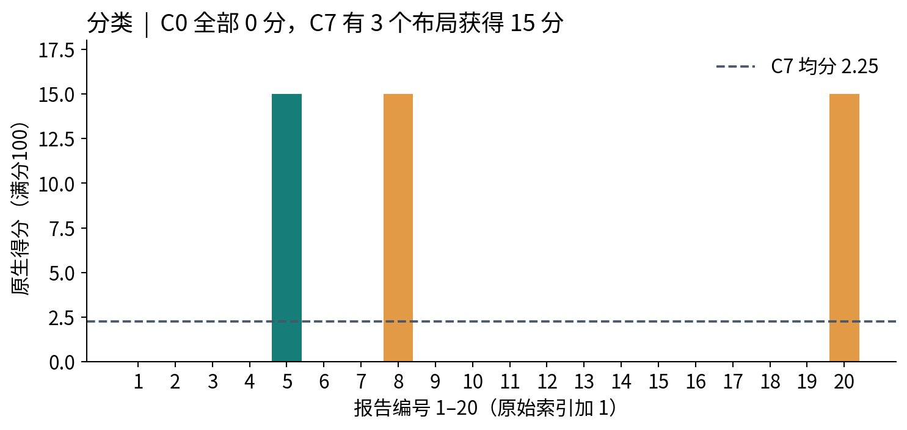

# 从普通抓取到多物体分类｜2026 年 11 月 16–22 日

研究先问一个可直接评分的问题：把视觉定位、到位纠正和持物判读接入普通抓取后，指定物体能否被抬高 10 cm？抓取配置筛选结束后，再检验这些改动能否帮助机器人将同类物体正确入筐。本周采用预先编写、冻结后执行的策略代码；两项任务分别使用自己的原生评分器。[六条科研日志](../../research/notes_20261122/W47.md)

## 普通抓取 · 136 回合

| 实验 | 实际新增 | 观测 |
|---|---:|---|
| 首次迁移 M0 | 3 开发 + 20 正式 | 历史原策略开发 2/3、正式 1/20；M0 为 0/3、0/20。18 个可判读动作窗口用于解释失败。[M0 配对及源码](../pickup_transfer_20261119/README.md) · [持物判读](m0/holding.json) |
| M1 放行闭爪与调整抬升 | 3 开发 | 打蛋器和塑料铲到达闭爪与起抬，均未达到原生成功条件；开瓶器停在接近规划。开发 0/3，触发停止条件。[代码](m1/code/) · [开发门槛](m1/development-gate.json) · [点云取点重放](m1/rule-comparison.json) |
| 十种配置配对筛选 | 10 × 8 = 80 | 每个版本共享 3 个开发、5 个历史正式布局。V2、V3、V6、V7 均成功 5/8，按辅助指标选出 V6、V7。[配置](pickup/variants.json) · [逐例](pickup/screening.csv) · [排序](pickup/selection.json) |
| 两个入选配置扩展 | 2 × 15 = 30 | V6、V7 各在筛选的 5 个正式布局中成功 4 次，在其余 15 个中成功 4 次，合计均为 8/20。V7 增加一次备用重抓，两版逐布局成败相同。[策略与几何实现](pickup/code/) · [正式配对](pickup/formal-paired.csv) |

两版均保留了历史策略成功的 8 号布局，新增成功布局为 1、4、7、12、17、18、19。20 个正式布局都参与过历史诊断；其中 15 个未参与本轮筛选。全新布局上的成功率仍待验证。

## 多物体分类 · 97 回合

| 实验 | 实际新增 | 观测 |
|---|---:|---|
| C0–C5 首次迁移 | 48 筛选 + 6 个 C0 扩展 | 48 个筛选回合全部 0 分。初轮扩展停止时已完成 6 个 C0 终局。[策略源码](classify/screen/code/) · [筛选表](classify/screen/screening.csv) |
| C3_fix 退臂诊断 | 3 开发 | 原 C3 回执供配对复用。C3_fix 的 7 次有记录退臂均未推进，3 对布局原生分差均为零。[代码](classify/dev_fix/code/) · [配对](classify/dev_fix/development.csv) · [终局抽查](classify/dev_fix/terminal-review.md) |
| C6、C7 闭环改进 | 40 新增，另复用 22 份回执 | C6 在退臂后重新观察与分配，C7 再调整下探、空爪拦截、重抓和投放位置。两者筛选均分均为 3.75，按预设顺序选出 C7。[闭环控制](classify/closed_loop/code/) · [筛选表](classify/closed_loop/screening.csv) · [选择记录](classify/closed_loop/selection.json) |

C0 与 C7 在同一批 20 个正式布局均为 **0/20 完整成功**。C7 在 3 个布局各获得 15 分，百分制均分从 0 提高到 **2.25**。其中 15 个留出布局有 2 个得分提高、13 个持平，均分差 **+2.00**。每个策略在每个布局只评一次；这一组合对照支持部分得分改善，单项改动的贡献仍待测量。[20 个正式布局的配对结果](classify/closed_loop/formal-paired.csv)

## 数据口径与核验

[回执总表](episodes.jsonl) 每行对应一个有效执行，含阶段、策略、数据划分、布局编号与哈希、原生回执的原文及 SHA-256。原文中的 score 为 0–1，表中的 score_100 为百分制；完整成功读取原生 success。总表的 layout_one_based 从 1 起，分类配对 CSV 的 index 从 0 起。M0 的 23 个回合已在前次发布，随本周统计仅计一次。闭环对照表中的复用基线和点云离线重放不另计新增回合。

在仓库根目录运行 `python3 -B tools/verify_w47.py` 可离线复算两项正式对照，并校验公开实验材料。策略源码按原批次保留，原生执行还需要对应的 RoboDojo 版本、仿真资产、感知权重和批次运行接口。[来源清单](../../provenance/w47-20261122.json) · [复现说明](../../docs/REPRODUCE.md)
