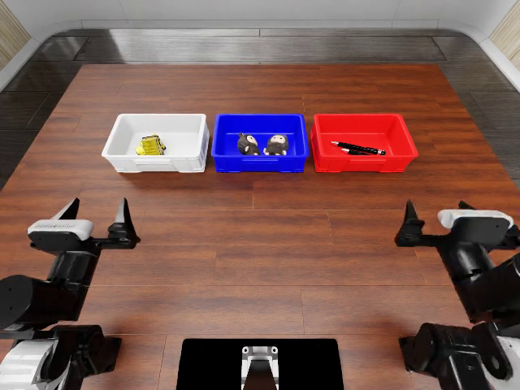

# 代表性原生视频与关键帧

本次收录既有资料包中的 13 段历史真实执行视频，并重点展示其中 3 段及各 1 张终末帧。原 MP4/PNG 字节未转码、未裁剪、未改色。逐条任务、布局、策略版本、来源、SHA256、fps、帧数与时刻见 `selected-videos.json`、`selected-frames.json`。

| 证据 | 场景与用途 | 必须同时说明 |
|---|---|---|
| [分类 Agent 成功](videos/V02_classification_agent_success.mp4) | classify_objects，layout6，历史 Qwen Agent | 组内仅 1/5 成功，不能用这一例代表平均效果 |
| [原候选跳过动作](videos/V05_diagnostic_skip_all.mp4) | classify_objects，layout2，round2 original_dense | 自然结束得分 0；需结合调用日志判断，静止画面本身不足以定位原因 |
| [边界修订后动作增加](videos/V06_diagnostic_bbox_more_actions.mp4) | 同 layout2，bbox_dense 人工机制对照 | 得分仍 0；不是自主选择的改进，也不是抓取已成功 |

视频采用 `frame_index/fps` 的编码时间。它不等于 API 时间、仿真物理时长或完整运行墙钟。视频是解释现象的有意选样，不用于计算成功率。新增的 GPT 两项补测没有随原四包提供 MP4，不能用这里的历史视频冒充。

全部 13 段视频在本目录的 videos/，任务、版本、时刻与哈希见 all-videos.json；39 帧完整集合仍在既有离线包和实验室，本仓库只保留重点展示的 3 张终末帧。
