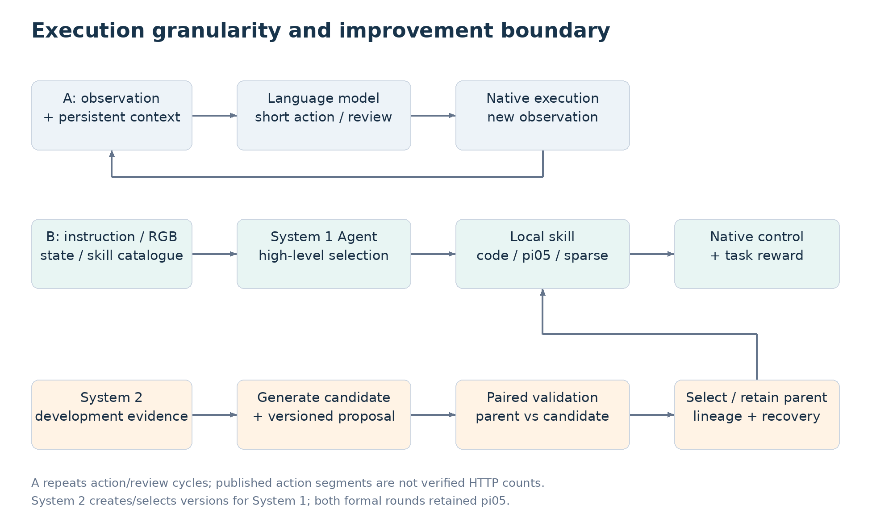
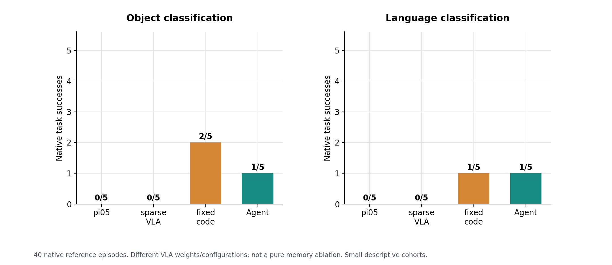
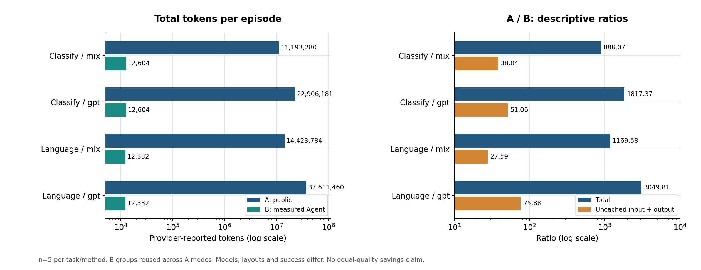
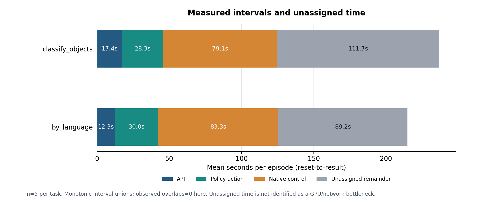
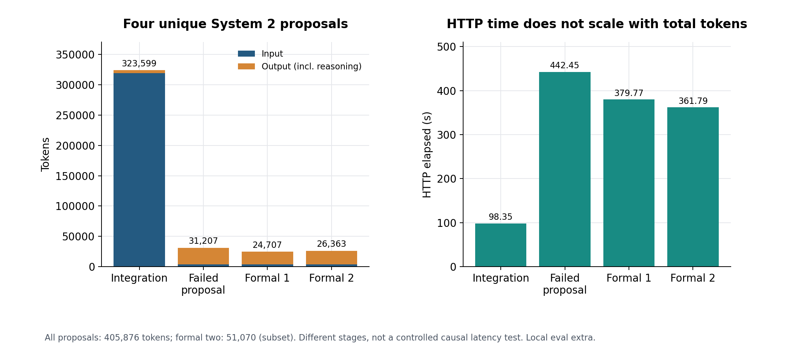
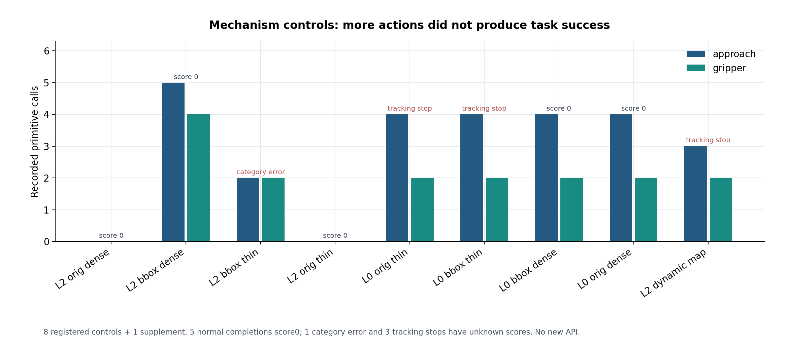
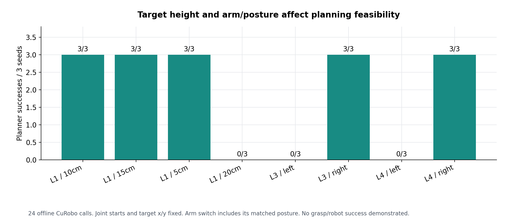
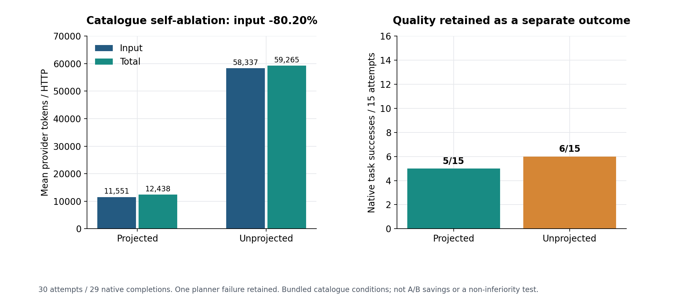

> 历史报告快照：科学数据截至 2026-10-31，部分整理核对完成于 2026-11-01。2026-11-02 GPT 补测请同时阅读 [最新研究总览](../../docs/RESEARCH_OVERVIEW_ZH.md)。历史报告中的“本次”“尚未开展”须按该快照日期解释；原件未改写。

# PhysicalRSI 有限范围复现与 Token、运行时间差异研究

2026-11-01全主机补全版｜实验数据截止：2026 年 10 月 31 日已完成批次｜中文报告，保留 English terms

> 本报告只复现 PhysicalRSI。GPT-as-Policy（项目 A）只作为固定官方公开资料参照，没有重新部署或执行。已完成的是有限任务的运行、改进、验证和证据闭环；未复现完整 RoboDojo 榜单，也未测得 System 2 性能提升。报告、图表与原始来源的逐项对应见 `02_结论证据表.csv` 和包内 `SOURCE_INDEX.csv`。

> 本轮补充CPU/静态审计、80次与120次API原件复核、旧/新分类队列、System2失败与人工修复时间线、公开成功分母和未知项。详细过程见逐阶段复核（归档路径：`05_逐阶段完整复核与补充分析.html`；完整原件见原资料包或实验室档案），完整性与下一轮设计见复核清单（归档路径：`06_报告完善性检查与未知项.html`；完整原件见原资料包或实验室档案）。没有新增API或仿真。

## 1. 研究问题、结果与证据强度

老师提出的任务包含两个相互关联、但不能混为一个数字的问题：第一，PhysicalRSI 是否能够在实际机器人仿真中运行，并完成其技能执行和自改进工作流；第二，为什么它与 GPT-as-Policy 公开报告中的 Token 数量和运行时间存在较大差异。

本研究沿着“公开证据固定 → 原生仿真复现 → 分项计量 → System 2 验证 → 独立验收 → 失败机制诊断”的顺序展开。研究中使用作者发布的预训练权重，没有重新训练模型。项目 A 的数值来自固定公开快照，项目 B 的数值来自本次云端真实运行和留存的供应商 usage。

目前能够成立的主要结论如下。

1. **工程流程已经完成有限范围复现。** L20 上真实运行了 Isaac Sim、RoboDojo、两种 VLA、代码技能和高层 Agent；System 2 两轮生成、原生验证、选择、父策略保留以及恢复检查均完成。已有真实视频和原生评分，不能再把这些阶段写成“尚未开始”。
2. **在线 Token 差距很大，但只能作有条件的描述。** 在两项同名分类任务上，A 的平均总 Token / B 的平均总 Token 为约 888–3050；剔除缓存输入后，`uncached input + output` 指标的比值为约 27.59–75.88。模型、tokenizer、布局和成功率不同，因此这些数值不是等质量节省倍数，也不是账单比值。
3. **主要结构解释是决策粒度不同。** 所测 B Agent 通常用一次高层规划选择技能，随后由本地 code/VLA 执行大量控制。A 持续生成较短动作片段，混合模式还反复审阅。远端语言决策的频率、上下文和推理输出不同，导致语言接口账目差异。A 的动作段数没有被证明等于 HTTP 请求数。
4. **运行速度的跨项目倍数仍然未知。** A 的公开物理时长不能与 B 的完整墙钟相除。本次 B 内部计时已拆分 API、取动作、原生控制和剩余时间；小样本连续进程补测没有观察到整体加速。
5. **System 2 没有带来得分提升。** 两轮父策略与候选验证均为 0 分，选择器均保留父策略。最终独立验收评估保留的 pi05：两项任务各 0/10。这个结果属于最终策略，不是整套 Agent 的最终成绩。
6. **负结果已形成具体诊断。** 已查到过宽的“已入篮”判断、特定高度/用臂下规划不可行、控制预算和跟踪约束冲突、新类别映射异常，以及候选反馈与 memory 回传不足。修复部分原因增加了动作或消除了异常，但尚未完成抓取/分类闭环。

证据强度需要分开理解：原生评分和 API usage 是直接测量；代码与调用层级支持机制解释；跨项目算法本身造成了多少比例的差距，当前没有同条件因果识别。小样本负结果也不能推广为“PhysicalRSI 在所有配置下无效”。

## 2. 两个项目分别在做什么

### 2.1 项目 A：GPT-as-Policy 的公开执行方式

项目 A 的官方网页为 `https://anonymous-report-421.github.io/public-website/?lang=en&view=1`。本研究固定其仓库 `8f3d362b077d8efb77e2a7274d5b2c20e2243846` 下的 `public_results/data.json`；数据 SHA256 为 `0c4be006a2a0dc1ca2559e4421c45680eec94d466f390ea34b2ea055af9bd74e`。公开数据报告日期为 2026-09-13，研究取证日期为 2026-10-29。数值分析固定这个快照，不把之后网页可能发生的更新混入同一批统计。

公开快照包含 100 条记录，即 `mix` 和 `gpt` 两种模式各 50 条。`mix` 结合 VLA 执行与语言模型检查/纠正；`gpt` 持续由语言模型产生动作片段。两个模式不是两种 HTTP API 名称。公开说明显示它保留持久会话和历史引用，因此不能描述成“完全没有记忆”，也不能简单断言“每次请求显式重发全部历史”。

从控制逻辑看，A 更频繁地把短时动作生成和审阅留在语言模型环路中。一个 episode 内出现许多 action segments，并不意味着公开数据已经披露了同样数量的 HTTP 请求：一次服务调用与内部回合、动作段的关系还需要服务端记录，本研究没有该证据。

公开全快照 `mix` 累计总 Token 为 624,762,828，`gpt` 为 1,132,343,772。它们是各自 50 条记录的累计值，不是单个任务或单次请求。公开全局成功情况与个别记录的可评分数量还存在口径区别；本研究主表只选两项同名分类任务的各 5 例，不以全快照平均值代替任务对照。

### 2.2 项目 B：PhysicalRSI 的技能执行

PhysicalRSI 的 System 1 负责当前任务的执行：读取任务指令、RGB 和机器人状态，结合技能目录、工具和 memory，选择可执行技能。当前复现保留了默认技能库的两条神经策略路线和 22 个已准备代码程序。

- `pi05`：发布的普通 VLA，接收视觉、语言和状态，产生机器人动作。
- `pi05-sparse-memory`：发布的稀疏视觉历史 VLA。它与普通 pi05 的权重、训练配置和结构不同，本研究没有做“只切换 memory 开关”的纯消融。
- `code-policy`：程序控制逻辑，通过场景感知、CuRobo 规划、approach 和夹爪等 primitive 运行。
- `Agent`：高层规划和路由，选择 composition 与 operations，再调用上述本地技能。Agent 不是第四个独立机器人权重。

在已核验的分类 Agent 参考记录中，每个 episode 有一次逻辑高层规划、一次实际 HTTP；冻结设置最多允许三次传输尝试。这不表示所有未来 PhysicalRSI 配置都只能调用一次，也不能把一次逻辑调用默认等同于一次 HTTP。

规划结束后，大量控制由本地 VLA 或程序执行。它们消耗 GPU、CPU、仿真和通信时间，即使远端规划 Token 为 0，也不能称为“零计算成本”。VLA 动作输出没有作为供应商语言 API Token 统计。

### 2.3 System 2 与 System 1 的关系

System 2 是改进闭环：收集开发任务证据 → 生成候选程序/配置 → 在原生任务中对照验证父策略和候选 → 根据选择规则保留一个版本 → 保存 lineage 和不可变快照。选中的版本再供 System 1 执行。

System 2 不等于模型训练，也不必在每个控制步运行。此次两轮生成的候选没有提高验证得分，因此保留父策略 pi05。由此可以同时成立两句话：“System 2 工作流跑通了”和“没有测得 System 2 的性能提升”。

还应区分三种 memory：VLA 的稀疏视觉历史；System 2 的内容寻址 memory/版本快照；生成 Python 程序读写的运行时字典。某一种机制的记录或问题，不能推广为另外两种机制的结论。

### 2.4 RoboDojo、Isaac Sim 与 CuRobo 在实验中的位置

RoboDojo 提供任务定义、布局、机器人接口、原生评分和评估记录；Isaac Sim 提供物理仿真和 RGB 渲染；CuRobo 为代码技能提供运动规划。它们共同构成“观察—决策—动作—新观察—评分”的实验环境。RoboDojo 本身不是自动包含 System 2 的另一个 Agent；System 2 是 PhysicalRSI 的改进层，通过适配器调用原生评估。

本次 L20 环境已经通过实际 RGB 与原生任务执行验证。实验室 H100 是否适合其他计算属于后续部署问题，不改变本报告的已测环境。

图1：A的重复短动作/审阅与B的高层技能路由。箭头表示工作流；动作段不等于HTTP。

## 3. 复现范围、版本与配置

### 3.1 范围

覆盖六种任务类型：`general_pickup`、`classify_objects`、`classify_objects_by_language`、`stack_bowls`、`cover_blocks`、`insert_tubes`。它们是有限的抓取、分类/语言、叠放、视觉历史/遮挡和插入操作观察，不能据此概括完整能力或榜单成绩。

本次不包含：运行项目 A、全部 RoboDojo 任务/随机变体、大规模训练、作者全部分数对齐、纯 memory 因果消融、真实机器人实验、System 2 增益证明。

### 3.2 环境与版本

| 项目 | 已冻结/实际使用条件 |
|---|---|
| 云端主机 | Alibaba Cloud ECS，16 vCPU，128 GiB 标称内存 |
| GPU | NVIDIA L20，46068 MiB，driver 580.126.09 |
| OS | Ubuntu 22.04.5 LTS |
| Simulator | Isaac Sim 5.1.0；Python 3.11；torch 2.7.0+cu128 |
| Policy | 独立 OpenPI 环境，torch 2.7.1+cu126；与 simulator 分离 |
| PhysicalRSI | `90b322a3a362aad14125f36d8ed080ca31daaea6` |
| RoboDojo | `09bd5f5e762b949f5858ece31347ce62057b3a5e` |
| XPolicyLab | `393f730788e7277c7d86829dd5806a924ac31e74`，按原始版本清单核验 |
| IsaacLab | `afca7b09d60d8beb9c1cb28b43066499940b969b` |
| CuRobo | `d17b54ce32cba095c0b000c4c58777075d11de0e` |
| 正式规划 API | `qwen3.7-plus`，temperature=0，enable_thinking=true，JSON object |
| 模型身份限制 | 供应商 alias；确切后端 checkpoint 未提供 |
| 分类任务控制 | physics dt=0.004 s；control dt=0.04 s；最多 1100 控制步 |
| 调用设置 | 1 次逻辑高层规划；最多 3 次 transport attempts；按实际 HTTP 计量 |

早期对话中的 Qwen3-VL-Plus 购买建议不能代替正式请求记录。正式统计采用冻结文件和实际 payload 中的 `qwen3.7-plus`。

### 3.3 兼容性适配与边界

部署并非毫无修改的作者原始环境。保存了图形库隔离安装、IsaacLab source binding、路径绑定、参数/依赖兼容性恢复、类型约束计时分支，以及 System 2 原生检查策略桥接等记录。正式批次的协议在运行前冻结；历史错误和修复没有删除。

两轮 System 2 使用了明确登记的 inspection-policy bridge，不能宣称从头到尾是一条完全没有变化的 policy hash 链。生成代码和候选 memory 内容的原始输出仍保留，人工诊断修复独立命名，没有冒充自主生成结果。

数据划分按照开发、验证、最终测试区分。独立最终验收使用 20 个此前开发/选择未使用的布局；这不等于证明布局从未进入发布权重训练集。三项扩展任务还对公开重复布局进行了规范化排除，避免把相同排列重复算为独立场景。

!六任务真实初态（归档路径：`../media/scene_atlas.jpg`；完整原件见原资料包或实验室档案）

图2：六种任务的真实初始RGB，任务、布局、策略与来源见 `media/scene_manifest.csv`。这些图不是额外评估。

## 4. 实验是怎样逐步完成的

### 4.0 本机预验证与固定输入API

在云端原生实验前，固定版本完成1007项上游CPU测试和6个软件fixture trial；fixture提案为脚本参数修改，不是真实模型自主改进。实际请求构造的12个离线样本定位了目录开销，代理tokenizer结果不作为供应商usage。

80次qwen3-vl-plus合成输入API有完整本地逐调用原件，总870,375Token；schema修订组输入减少67.34%、总量66.88%、请求均时21.22%，但pilot多数计划不符合契约，不能以HTTP200代替有效计划。后续120次原件复核确认总2,204,597Token、输入下降67.31%、请求均时下降31.65%；120原响应、40请求及326项历史manifest本轮均已核验。二者都没有机器人动作，不能替代原生任务表现。详见补充§2–4（归档路径：`05_逐阶段完整复核与补充分析.html`；完整原件见原资料包或实验室档案）。

### 4.1 部署与最小闭环

先检查 CUDA、Vulkan 和 RGB 渲染，再加载官方 `general_pickup` 布局 0。原始指令是将 mint-green scissors 抬升 10 cm。原生场景检查确认相机、关节状态和布局稳定性，但这种检查本身不代表抓取成功。

随后分别直接调用固定 pi05 和稀疏历史 VLA：早期单例 pi05 未抓起目标，稀疏历史路线成功。两者都没有 Agent 高层规划，API Token 为 0。每种仅一个初始样例，不能由此得出稀疏记忆整体优于普通 VLA。

之后保留完整技能库并接入真实高层规划。双 VLA 共同加载、代码程序准备、真实动作维度和 RGB 接口均经过检查。部署成功、原生任务成功、统计上的能力提升是三种不同的验收层次。

### 4.2 早期 general_pickup 59 案例

早期开发 suite 共 59 个评估案例，58 个进入并完成原生评估，1 个思考模式规划格式失败；另有 6 个 API-only 模式检查，不是 6 个机器人 episode。

| 路线 | 布局 0 的重复控制 | 新布局 1–10 |
|---|---:|---:|
| pi05 | 0/3 | 0/10 |
| pi05-sparse-memory | 1/3 | 0/10 |
| 固定 code | 3/3 | 4/10 |
| Agent，non-thinking | — | 0/10 |
| Agent，thinking | — | 7/10 |

思考模式的有效计划主要选中代码程序，非思考模式在 10 个新布局中均选择 pi05；思考模式布局 5 的无效 composition 保留在分母，没有重试到成功。思考组与固定代码组使用相同冻结代码，但 RGB 和执行波动不完全一致，因此 7/10 与 4/10 的差距不能全部归因于语言推理。

该 suite 的 API 请求共 26 次，315,294 个供应商总 Token，包括 6 个 API-only 检查的账目；不是 26 个成功机器人任务。GPU 三秒采样峰值 28,127 MiB，采样峰值不保证捕获绝对瞬时最大值。

### 4.3 分类任务 System 1 参考矩阵

这里固定使用Run24 v3的布局5–9。Run20/21另有布局0–4的旧Agent队列，普通分类1/5、语言分类0/5；正式参考为1/5和1/5。不同队列不混合、不挑好结果替换。typed接口replay两组均6/6合法，typed native另为0/3，未建立格式或任务改善。[队列对照](../../reports/evidence/tables/agent-cohort-separation.csv)保留差异。

协议冻结后，两个任务 × 四种路线 × 五个布局，得到 40 个参考 episode；另做 5 个失败一致性诊断。每格只运行一次，不是大样本成功率估计。

| 原生成功数 / 分母 | classify_objects | classify_objects_by_language |
|---|---:|---:|
| pi05 | 0/5 | 0/5 |
| pi05-sparse-memory | 0/5 | 0/5 |
| 固定 code | 2/5 | 1/5 |
| Agent | 1/5 | 1/5 |

核验内容包括真实路线、记忆读取与历史重置、指令和初态、版本和视频。普通 VLA 与稀疏历史 VLA 训练/结构不一致，所以两行不能作为纯 memory 开关消融。代码组比 Agent 多成功一例也不能在 n=5 下直接证明普遍优势。

这 10 个 Agent 参考 episode 是后续跨项目主表中的 B；不使用最终固定 pi05 的 20 例替换它们，也不拿 general_pickup 的 7/10 混进分类任务。

图3：参考矩阵40例，非纯memory消融。

## 5. Token 的定义与跨项目结果

### 5.1 先统一账目

对于本报告使用的供应商字段，采用：

`total = input + output`

`uncached_input = input - cached_input`

`uncached_metric = input - cached_input + output`

`cached_input` 是 input 的子集；已在 output 内报告的 `reasoning_output` 是 output 的子集。二者都不能再次加到 total 上。Token 数不等于货币费用，缓存命中可能采用不同计费/计算路径；未取得两方完整账单，不能换算实际省钱倍数。

主表按任务与方法计算每例均值，再算两方均值之比：`mean(A_total) / mean(B_total)`。这不是逐例配对因果估计。A 与 B 的布局、模型和成功率不同。

### 5.2 对应任务主表

| 任务 / A 模式 | A 成功 | B Agent 成功 | A 每例总 Token | B 每例总 Token | A/B 总 Token 比 | A/B 未缓存指标比 |
|---|---:|---:|---:|---:|---:|---:|
| 分类 / mix | 3/5 | 1/5 | 11,193,280.4 | 12,604.0 | 888.07 | 38.04 |
| 分类 / gpt | 5/5 | 1/5 | 22,906,180.8 | 12,604.0 | 1817.37 | 51.06 |
| 语言分类 / mix | 1/5 | 1/5 | 14,423,783.8 | 12,332.4 | 1169.58 | 27.59 |
| 语言分类 / gpt | 2/5 | 1/5 | 37,611,460.2 | 12,332.4 | 3049.81 | 75.88 |

A 的这四格各有 5 例，但两种 A 模式共享同一任务的 B 参考组，不能把主表四行的 B 再累计成 20 个不同 episode。B 的两项任务实际各 5 例，合计 10 例。

A 在四格中的缓存输入 / 输入比例约为 97.34%、98.25%、97.81%、97.70%；B 分类约 35.92%，语言分类为 0。缓存比例的分母是 input，不是 total。对比总 Token 和未缓存指标后，数量级差距明显缩小，说明“缓存账目”是解读巨大比值的必要条件；它仍不能独立解释每一部分差距。

图4：对数坐标，四格描述性比较。模型、任务条件和成功率不同。

### 5.2.1 公开分母和成本分层

A全快照mix为50尝试/50可评分/24成功；gpt为50尝试/48可评分/13成功，另外2条未完成分别在语言分类与pack。成本仍包含50次尝试；成功不能把13/48与13/50混写。[公开分母复算](../../reports/evidence/tables/public-A-full-snapshot-denominators.csv)。

B普通分类Agent成功1例总Token12,302，失败4例均值12,679.5；语言分类成功1例12,079，失败4例12,395.75。成功层太小，且是按结果后选择，只作描述。低Token失败不能证明高效率完成同样任务；A/B成功率不一致尤其限制效率解释。[成本分层](../../experiments/history/task_extension_and_final_test/final-review/outcome-cost-strata.csv)。

### 5.3 调用机制支持什么解释

| 维度 | A：官方公开资料 | B：本次核验 |
|---|---|---|
| 语言决策粒度 | 持续短动作片段、审阅/纠正 | 一次高层技能规划后本地执行 |
| 模型 | GPT6Astra，xhigh | qwen3.7-plus，thinking=true |
| 上下文 | 持久会话/历史，较高缓存输入 | 技能目录、指令、RGB 与状态 |
| 实际 HTTP | 未公开到可核实层次 | 分类参考每例 1 次 |
| action segments | 四格均值 75、151.4、91、182.8 | 与远端 HTTP 不是同一字段 |
| 本地计算 | 公开控制/混合策略 | VLA、感知、规划、仿真持续运行 |

解释链条是：语言环路保留的控制职责更多 → 决策/审阅和上下文使用方式改变 → 总输入、缓存输入和推理输出分布改变 → API 成本和时间发生变化。现有证据不能把 888–3050 全部归因于“调用次数”，因为 A 的 HTTP 次数未知，也不能全部归因于提示词长度。

另一项重要差异是成功条件。更短、更少 Token 的失败执行不能直接证明效率更高。报告保留成功/失败分层表；小样本下按“成功数”简单除总成本也会不稳定，不用它代替完整任务质量比较。

### 5.4 提示词大小与调用频率的直接证据

B 分类参考每次平均输入 11,546 Token、平均输出 1,058；语言分类平均输入 11,588.8、平均输出 743.6。所核验的请求有 3 张图像，供应商为这些输入报告 906 image tokens。文本、图像与缓存统计存在包含关系，不另加到 prompt_tokens 上。具体字段见 `tables/prompt_structure.csv`。

例如分类第一个请求的 system 文本为 1,296 字符，user JSON 文本为 46,263 字符；这只是可重复的文本长度，不能用固定字符/Token 系数代替供应商测量。user context 包括 instruction、observation、task_specific_policy_memory、previous_plan、available_compositions 和 operation_program。包内保留了原始请求、响应和对应 RGB，能够进一步追踪上下文组成。

目录辅助消融中，精简与完整目录的平均输入分别为 11,550.8 和 58,336.8 Token（每组 15 次实际传输）。这说明目录确实影响本项目的请求规模；但 A 的逐请求上下文并未公开，不能把这组自身消融的降幅直接用于两项目归因。

## 6. 时间究竟测量了什么

### 6.1 三种时长

1. **物理/名义控制时长**：控制步数 × control dt。它描述仿真动作覆盖的时间，不包含语言等待、进程启动等。
2. **API 时间**：实际 HTTP 请求/响应区间，包括该区间中的远端生成与网络等待；逻辑调用还可能含本地处理、重试等待。
3. **墙钟时间**：`reset-to-result` 为一次 episode 的 reset 到返回结果；full wrapper 还可包括启动、载入、清理等。批次时间又包含预热和 episode 间开销。

同一主机的单调时钟区间先求并集，重叠部分只计一次。未归属剩余项 = reset-to-result − 已测区间并集；不能直接重命名为“GPU 推理”或“网络瓶颈”。

### 6.2 B 分类 Agent 的分项计时

| 5 例参考均值，秒 | 分类 | 语言分类 |
|---|---:|---:|
| reset-to-result | 236.53 | 214.76 |
| API 区间并集 | 17.40 | 12.27 |
| policy 取动作区间并集 | 28.30 | 30.04 |
| 原生控制区间并集 | 79.12 | 83.26 |
| 剩余未归属 | 111.71 | 89.19 |
| API / reset-to-result | 7.36% | 5.71% |

这些区间在该汇总中没有观测到交叠，因此可以组成图中的总量；定义仍以区间并集为准。API 只占部分时间，减少语言 Token 不会自动等比例减少整个 episode 时间。

图5：每项5例均值。剩余项尚未识别具体瓶颈。

### 6.3 为什么增加了针对性计时补测

旧连续运行存在两个规划格式错误提前退出，不能把缩短的失败流程当作加速。旧类型约束分支又只有冷启动数据，缺少同接口的连续组。因此在原流程完成后，只为这个明确缺口补测 7 次：3 次独立进程 + 连续进程的 1 次预热和 3 次测量。

三对都完成原生任务，且指令/机器人初态一致；composition 和 operations 一致，控制步数均为 1100；但三相机 RGB 并非逐像素一致。进程冷启动没有清空 OS、GPU 或远端 API 缓存。

| 布局 | 冷启动 reset-to-result/s | 连续 reset-to-result/s | 冷−连续/s |
|---|---:|---:|---:|
| 0 | 231.88 | 228.61 | +3.28 |
| 1 | 232.44 | 234.12 | −1.68 |
| 2 | 231.44 | 247.40 | −15.96 |
| 均值 | 231.92 | 236.71 | −4.79 |

冷启动完整 wrapper 合计 835.75 s；连续批次含预热 987.28 s。两者完成工作量不同，连续批次多一个预热 episode，不能当作三个 episode 的严格同工作量速度估计。本条件未观察到整体加速，样本只有 3 对，不推广到长期运行。

补测 Token 共 87,192，其中正式配对 74,862、预热 12,330。冷启动合计 37,977，连续正式 36,885，含预热 49,215。预热必须进入批次账目。

!针对性计时补测（归档路径：`../figures/05_targeted_timing.png`；完整原件见原资料包或实验室档案）

图6：3对有效比较；完整批次工作量不同，没有建立跨项目加速倍数。

### 6.4 跨项目速度为什么不能给倍数

A 公开的分类/语言分类名义控制时长约 30–42 s，与 B 的 reset-to-result 约 215–237 s 是不同统计对象。A 完整墙钟及实际 HTTP 次数未知，本研究不补造、不用 action segments 代替，也不由 B 的内部补测反推出 A 的缺项。

“总 Token 更多”也不能直接等比例推出“等待更久”：System 2 接入提案 323,599 Token、HTTP 98.35 s，而两轮正式提案共 51,070 Token、HTTP 741.56 s。它们输入/推理输出构成、阶段和条件不同；这个观察说明固定 Token→时延换算不成立，不是同条件因果对照。

## 7. System 2 两轮真实改进实验

### 7.0 在两轮正式完成之前发生了什么

Run25集成提案、Run26类别键解析中断、Run27人工CPU修复、Run28/29门禁检查、Run30父策略准入失败与登记bridge都已保留。Run26有15个完成native和1个候选中止，0轮提交；人工修复不算模型自动改进。最后Run31完成两轮，40个逻辑回合有30个复用、10个续接新执行，不能重复累计。详见补充§11（归档路径：`05_逐阶段完整复核与补充分析.html`；完整原件见原资料包或实验室档案）。

### 7.1 流程与选择结果

每轮先收集 pi05 和稀疏历史 VLA 的开发结果，各 5 例，再生成候选，并在配对验证中对父策略和候选各测 5 例。开发路由阈值使用平均原生部分得分，不等于完整任务成功阈值。最后由冻结选择器决定是否采用候选。

| 项目 | 正式第 1 轮 | 正式第 2 轮 |
|---|---:|---:|
| pi05 开发均分 | 0 | 0 |
| sparse-memory 开发均分 | 0.27 | 0.11 |
| 父策略验证 | 0/5 成功，均分 0 | 0/5 成功，均分 0 |
| 候选验证 | 0/5 成功，均分 0 | 0/5 成功，均分 0 |
| 官方选择 | retain_parent | retain_parent |
| 拒绝原因 | no_sufficient_improvement | no_sufficient_improvement |

候选源代码和执行绑定与父策略不同，确实进入原生执行。日志中的 actor stopping 在已核验案例里属于清理/取消记录，不能看到这个词就断言候选从未执行。

两轮共 40 个逻辑原生回合，包括开发和验证，不等于最后续跑阶段新执行了 40 次。最终续接记录明确复用了 30 个已有回合，新执行 10 个。跨文件/续跑统计必须按实际执行凭据去重，不能把复用副本再算一遍。

### 7.2 提案账目：保留失败成本

| 阶段 | 输入 | 输出 | 总 Token | HTTP 秒 |
|---|---:|---:|---:|---:|
| 原生接入提案 | 318,818 | 4,781 | 323,599 | 98.35 |
| 保留的失败提案 | 3,629 | 27,578 | 31,207 | 442.45 |
| 正式第 1 轮提案 | 3,836 | 20,871 | 24,707 | 379.77 |
| 正式第 2 轮提案 | 3,831 | 22,532 | 26,363 | 361.79 |
| 四个唯一提案合计 | 330,114 | 75,762 | 405,876 | 1282.36 |

两轮正式提案小计 51,070；加一次失败提案为 82,277；再包含接入阶段才是 405,876。这三个是包含关系，不能相加。提案 HTTP 时间也不包含全部原生开发/验证仿真时间。

System 2 的生成和试验成本应与 System 1 单次在线执行分开列示。发布技能在作者侧的训练/研发总成本未在本研究中测量，不能把本次 System 2 成本当作完整生命周期成本。

图7：四个唯一提案；正式两轮为子集，不重复累计。

## 8. 独立最终验收与恢复检查

### 8.1 独立最终验收

最终选中版本与父策略的行为组件相同，绑定 `pi05`；核验相同后只执行一组 20 例，而非伪造“父组 20 + 改进组 20”。普通分类和语言分类各 10 个新独立布局，结果各 0/10，部分均分均为 0，全部到达 1100 原生控制步。

语言任务使用预注册、只为报告测试的任务绑定迁移，同一个 pi05 行为组件；没有在语言任务上新生成/训练/选择候选。评估阶段规划 API=0，也不抹去此前的改进成本或本地 VLA 推理成本。

最终验收检查了布局与此前历史不重叠、源绑定、视频和 frame 数。20 例共 60 个三相机视频、66,060 帧。这组成绩属于最终保留的固定策略，不能写成“PhysicalRSI Agent 两项任务均为 0/10”。

### 8.2 状态恢复

完成了新进程载入版本和 memory、已完成步骤不重复执行、失败候选拒绝、stale head/不确定阶段阻断、隔离副本回滚、损坏检测与精确快照恢复。两个原生 recovery smoke（baseline/restored）均完成 1100 步、0 分；它们验证的是恢复后仍能绑定并执行同一策略，不证明性能提高，也不是新的独立最终测试。

原始已完成记录保持不变；没有测试整机断电、云盘损坏、整盘丢失或供应商服务故障恢复。本次汇报包不代表实验室迁移完成。旧2026-10-31快照中的Broken pipe/failed属于历史观察；本版2026-11-01只读状态快照显示另一个对话管理的迁移正在持续传输，尚无本任务核验的完成receipt。本任务未停止、重启或修改它，本机汇报包不依赖该迁移。

## 9. System 2 未改善的机制诊断

### 9.1 对照设计与结果分母

诊断选择布局 0 与 2，对“入篮判断 original/bbox 修正”与“轨迹 dense/thinned”做预登记 2×2，对每个条件各尝试一次，共 8 个；再做 1 个动态类别修正补测。另有 24 次离线 CuRobo 规划。它们是有意挑选的机制案例，不是随机成功率测试。

9 个尝试中：5 个正常结束并取得原生评分，均 0 分；1 个类别异常；3 个运动跟踪保护中止。异常没有自然完成的评分，记为 unknown/null，不能归成“9 个正常零分”。新增 API 和 Token 均为 0。

| 布局 | 条件 | 终止 | 得分 | approach | gripper | no_path | 已完成 primitive 步 |
|---|---|---|---:|---:|---:|---:|---:|
| 2 | original_dense | completed | 0 | 0 | 0 | 0 | 0 |
| 2 | bbox_dense | completed | 0 | 5 | 4 | 2 | 947 |
| 2 | bbox_thinned | category_exception | 未知 | 2 | 2 | 1 | 34 |
| 2 | original_thinned | completed | 0 | 0 | 0 | 0 | 0 |
| 0 | original_thinned | tracking_rejection | 未知 | 4 | 2 | 0 | 45 |
| 0 | bbox_thinned | tracking_rejection | 未知 | 4 | 2 | 0 | 45 |
| 0 | bbox_dense | completed | 0 | 4 | 2 | 0 | 835 |
| 0 | original_dense | completed | 0 | 4 | 2 | 0 | 835 |
| 2 | bbox_thinned_dynamic_mapping | tracking_rejection | 未知 | 3 | 2 | 1 | 34 |

这里的 primitive steps 只计完成的 primitive，不等于整个 episode 的控制总步数。代码结束后仍可能执行保持动作直到 1100 步；1100 也不能理解为 1100 次有效抓取尝试。

图8：5次正常0分，4次异常评分未知。更多动作不等于成功。

### 9.2 入篮边界过宽：为什么完全没有动作

生成代码用篮子中心 x/y 各 ±0.2 m 判断“已在篮内”，相当于 40×40 cm 范围；接口给出的篮子尺寸为 20×15 cm，即半宽 0.1/0.075 m。布局 2 中这会跳过全部可见物体。

只修正这个判断，布局 2 从 0 次 approach/夹爪变成 5 次 approach、4 次夹爪，但仍然 0 分。这支持“过宽判断造成不执行”的局部解释，不支持“修好了分类”。实际移动、夹持、正确分类和完整任务成功是不同层次。

### 9.3 规划目标：为什么请求动作却找不到路径

对记录的关节起点、目标 x/y 和其他条件做固定检查：布局 1 的 20 cm 抬升 0/3 规划成功；分别改成 15、10、5 cm，各 3/3。布局 3、4 的右侧目标用左臂及其姿态各 0/3，改右臂与对应姿态各 3/3。

共 8 个条件 × 3 个随机种子 = 24 次规划；换臂同时使用对应姿态，因此不能声称是“只改变 arm 标签”的单变量检查。这里的规划成功只说明求解器在该条件找到了路径，不代表已执行，也不代表完成抓取。规划失败也不是数学上不可达的证明。

图9：24次planner调用，未把规划通过当原生任务成功。

### 9.4 轨迹密度：为什么减少点数仍不等于加速

布局 0 的密集轨迹已完成动作消耗 835 步，后续动作受到 1100 步预算约束。简单抽稀减少了返回轨迹点，却触发实际关节偏离计划轨迹的 tracking guard。实验没有放宽保护阈值。

因此下一步应建立带到位确认与跟踪约束的执行契约，再测单位动作步数和墙钟。不能仅通过删点或取消保护制造“更快”的表象。

### 9.5 动态类别与感知身份

候选按首次观测建立类别映射，后续出现新识别的 `pen` 时发生 KeyError。独立补测允许新类别增量加入，同时保留旧映射；KeyError 消失，并继续产生第 3 次 approach，但随后被跟踪保护中止。

修正异常不是抓取成功。布局元数据离线核对表明初始 RGB 检测可能漏掉物体/类别；名称也不是稳定跨帧 ID。仅凭“当前看不见对象”不能推断已经分类完成。真值布局没有提供给策略。

### 9.6 System 2 获得的反馈不足

两轮正式提案的 `current_code` 和 `memory` 均为空，反馈主要是各 10 条 VLA 开发结果，具体诊断字段为 action_count 和 step_limit；上一候选的逐项 RPC 失败没有作为下一轮输入。因为拒绝后保留父策略，下一轮仍从父策略出发，而非保证对前一份失败程序持续修补。

两份生成策略均未读取 memory；第二份在结尾写了三个常量，但当前隔离执行器只导出 policy 返回值，不回传修改后的字典。这个问题限定于已测分支/接口；不能表述为所有 PhysicalRSI memory 都失效。

这些观察给出下一轮可操作的研究变量：给候选真实的代码与结构化失败轨迹、澄清 memory 的读写/回传契约、先保证动作请求的执行与终止语义稳定，再验证新布局。

!反馈接口与候选失败点（归档路径：`../figures/11_failure_mechanisms.png`；完整原件见原资料包或实验室档案）

图10：已观察接口和诊断现象的概括；不代表全部失败原因已被因果识别。

## 10. 三项有限扩展与目录辅助消融

### 10.1 三项扩展

每项先做 1 个 smoke，再做 5 个正式案例；3 个 smoke 排除在正式成功率外。

| 正式任务 | 成功 | 部分得分均值 | HTTP | 总 Token | 平均 reset-to-result/s |
|---|---:|---:|---:|---:|---:|
| stack_bowls | 1/5 | 0.20 | 5 | 63,581 | 134.81 |
| cover_blocks | 3/5 | 0.64 | 5 | 65,167 | 129.61 |
| insert_tubes | 4/5 | 0.88 | 5 | 62,559 | 110.34 |

这些任务不在 A 的公开主对照中，不做跨项目 Token 比值。`cover_blocks` 的流程包含覆盖并再按要求揭开，不能仅因末帧露出积木而判失败；具体成功仍以原生评分和完整视频为准。五例观察不能证明完整泛化、长期记忆或全部精细操作能力。

### 10.2 目录精简辅助消融

5 个开发布局 × 3 次重复 × 两种目录条件，共 30 个案例：projected 成功 5/15、原生完成 15；unprojected 成功 6/15、原生完成 14，另 1 个规划失败保留分母。另有 10 个 API-only replay，不是另外 10 个机器人 episode。

projected 共 186,568 总 Token，unprojected 888,970；输入下降 80.1998%，总 Token 下降 79.0130%。这是 PhysicalRSI 自身目录条件改变的辅助结果，不能用来表述 A/B 节省 80%。

两组输入分别 173,262 / 875,052，输出分别 13,306 / 13,918；两组均报告 0 cached input。每次传输平均总 Token 为 12,437.87 / 59,264.67。平均 HTTP 时间为 14.56 / 18.27 s，但完整 wrapper 均值约 127.92 / 128.58 s，且包含一例规划失败与不同任务结果；不据此宣布端到端速度提升。

投影还影响任务标签、可用目录与代码身份描述，因此不是只把字符串长度压短的纯对照。4 个可比较 replay 的 composition/有序 operations 未变，1 对不可用；这不足以证明质量非劣、所有任务路线不变或端到端加速。原始与修正报告均保留，采用 v2 的修正解释。

图11：自身条件对照的输入降幅；不能移植为A/B节省比例。

## 11. 总账、来源冲突与研究可信度

### 11.1 不合并为一个“总成功率”

不同阶段的任务、策略、布局、角色和终止条件不同，不能把它们相加后给出总成功率。本报告保留各自分母：早期 59 案例、目录 30 案例、分类 40 参考+5 诊断、两轮 System 2 的 40 逻辑回合、2 个恢复 smoke、3+15 个扩展、20 个最终测试、7 个计时尝试，以及 8+1 个机制尝试和 24 个离线规划。

其中存在证据复用和阶段包含关系。这个列表是账目导航，不是可直接求和的“全部新执行总数”。三项扩展+最终测试+针对性计时的闭环子集为 45 尝试，其中预跑、预热、正式和最终角色仍分别列示。

云端留存供应商响应去重后为 142 个唯一 response id、3,060,918 个已知总 Token，排除 2 份复制响应。这是留存可按ID核对的全阶段账目，已包含许多分阶段数字；不能再与 405,876 等小计相加，也不等于供应商账单。最新机制诊断新增 API=0。另有两份无response id的云端连通摘要共596Token，单列，不把142称作所有云端调用；跨主机账目见07§7。

### 11.2 已发现并处理的解释风险

- 旧阶段报告中的“尚未开始”是当时时态；以 Run34 最终闭环和 Run36 完成记录更新最新状态。
- System 2 的 82,277 是子合计，完整四提案为 405,876；两轮正式仍单列 51,070。
- 旧连续组因格式错误提前结束，计时主结论采用 Run35 的一致接口补测，原失败保留。
- 目录报告 v2 修正 replay 比较和时间定义，不改写原始结果；使用 v2，保留旧文件以供追溯。
- 最终验收 parent=selected，按一次 20 例计，不声称 40 个独立对照或 Agent 成绩。
- Run36 异常 score 为 null，主报告的“5 个正常 0 分”不能扩成“9 个正常零分”。
- 物理时间、API 时间与墙钟不互相替换；缓存和 reasoning 子集不重复加；缺失字段保留未知。

### 11.3 尚未排除的差异

没有发现足以解释全部低成功率的明显动作维度、任务规则、权重绑定或冻结源码错配，但尚未排除全部部署/数值差异。模型别名可能映射到供应商后端更新，发布权重训练覆盖未完全公开，RGB 与运行负载也存在波动。因而低分不能简单一概归因于算法，也不应冒充作者结果。

本次只读整理采用云端原始根目录；整理目录映射和完成 receipt 也已检查。已有实验室迁移是独立任务，不以包内旧 `raw_retention=cloud_only` 字段或迁移计划假定最终迁移成功。科学原件没有因报告生成而重写。

!有限扩展与最终固定策略（归档路径：`../figures/03_extension_and_final.png`；完整原件见原资料包或实验室档案）

图12：不同任务和角色分开列示；右侧不是完整Agent。

## 12. 下一轮实验：以诊断问题为中心

下一轮不再无目的扩大全榜单或重复相同失败条件。先在新的开发场景上验证执行契约，再让 System 2 获得更好的反馈，最后做少量新独立布局测试。以下是建议方案，**本次未执行**。

| 实验 | 处理变量 | 保持不变 | 主要验收指标 |
|---|---|---|---|
| E1：反馈完整性 | 原反馈 vs 加 current_code、结构化 RPC 失败/阶段信息 | 同父策略、模型设置、提案预算、开发/验证划分；不提供最终测试信息 | 候选能指出真实错误；契约通过率；新验证得分/成功；全部失败成本 |
| E2：执行契约 | 原密集执行 vs 带到位确认/时间参数化的受约束执行 | 相同目标、起点、planner、guard 阈值、任务步数上限 | tracking rejection、动作完成率、误差、有效步数、完整墙钟；不以抽稀点数作验收 |
| E3：动态对象 | 首帧映射 vs 增量类别与稳定对应 | 相同感知模型、RGB、布局分布、运动策略 | KeyError=0、映射保持、错绑率、漏检处理；再看任务得分 |
| E4：可达目标 | 固定高度/固定臂 vs 受约束高度与臂/姿态选择 | 同对象、关节起点、碰撞/任务约束；高度和换臂因素分开登记 | 离线规划率 → 实际到位 → 抓取/放置 → 原生成功，逐层验收 |
| E5：memory 契约 | 仅返回 policy 值 vs 明确允许的 memory 返回/校验 | 同程序、初始 memory、隔离边界和消息格式 | 写后读一致性、不可变 revision、非法变更拒绝；未用 memory 不声称收益 |
| E6：独立小样本验收 | 冻结后的新候选 vs 父策略 | 新布局、相同控制/模型/重试和成功定义 | 每格分母、成功/部分分、异常率、API 与完整墙钟；不使用原最终集调参 |

建议先做 CPU 契约与少量原生 smoke，再预登记 5–10 个新布局的父/候选配对验证。样本只用于初步判断，不能据此宣布总体显著改进。修改可达高度、增加动作或消除异常只是中间指标；真正通过必须有原生任务成功且安全约束成立。

若继续研究速度，先在 B 内冻结同模型、任务和动作结果，比较同工作量的 API/执行/启动分项，并明确预热是否摊销。A 端到端时间与 HTTP 计数仍需作者公开资料或另行获得记录，不能自行推断。

!证据工作流（归档路径：`../figures/10_evidence_workflow.png`；完整原件见原资料包或实验室档案）

图13：已完成阶段及其分母，不构成一个合并成功率。

## 13. 汇报时可以直接使用的表述

“我完成了 PhysicalRSI 在 L20 云端的有限任务复现，包括技能/Agent 执行、两轮 System 2 原生验证、父策略保留、独立最终验收与状态恢复。与 GPT-as-Policy 的固定公开分类记录相比，在线总 Token 的描述性差距很大，但缓存输入、模型与成功率差异使它不能直接解释为同质量节省。最明确的结构差异是高层技能路由与持续短动作审阅的决策粒度。当前不能给出跨项目墙钟加速倍数。两轮 System 2 没有提升得分；诊断已定位到执行契约、类别映射和反馈不足等问题，下一轮将先验证这些具体机制，再做独立小样本测试。”

汇报时应同时展示一段成功视频、一段失败/诊断视频和相关原生结果。视频用于说明现象，成功率仍以对应协议下全部案例为分母。选中的演示是代表案例，不是随机抽样，不能替代统计表。

## 14. 如何查证本报告

先读 `02_结论证据表.csv`，按 claim id 查报告结论、任务/样本、统计口径和图表，再在 `SOURCE_INDEX.csv` 查包内副本、原始云端路径与 SHA256。`tables/` 保留可编辑 CSV/JSON；`figures/` 包含 SVG 和 PNG 及绘图脚本；`media/` 有视频清单、真实关键帧及其时间和布局说明。原始实验报告、失败案例和协议与本报告同时提供。

本 ZIP 是可独立制作汇报的研究资料包，不是安装完即可重跑整个仿真的机器镜像。未打包的模型权重、环境、全体视频/逐帧观测与其云端来源在清单中明确区分，避免另一台电脑误以为所有运行依赖均在 ZIP 中。

## 15. 2026-11-01逐项复核补充

本次42个云端编号目录均列出性质、排除/复用规则与分析位置，另补本机历史证据。全部新增分析分为逐阶段完整复核（归档路径：`05_逐阶段完整复核与补充分析.html`；完整原件见原资料包或实验室档案）和20项跟踪问题（1闭合、19保留限制）、样本与下一轮方案（归档路径：`06_报告完善性检查与未知项.html`；完整原件见原资料包或实验室档案）。当前证据足以描述测得成本与失败机制，不足以补出A墙钟或等质量因果效率。旧ZIP保持原样，新版独立发布。

> 全主机补全版读取提示：新增07全主机总览（归档路径：`07_全主机实验总览与详细结论.html`；完整原件见原资料包或实验室档案）和08证据链分析（归档路径：`08_证据链与失败机制逐项分析.html`；完整原件见原资料包或实验室档案）；补入本机早期机制、实验室120原件与H100兼容性。20项跟踪问题中U05已闭合，其余19项保留限制。13原视频、39关键帧；服务器均只读，无新增实验。
