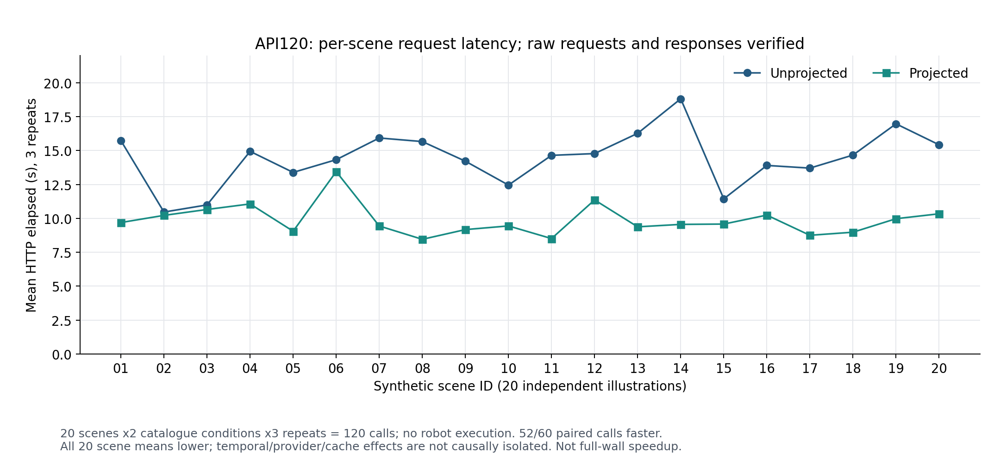

> 历史报告快照：科学数据截至 2026-10-31，部分整理核对完成于 2026-11-01。2026-11-02 GPT 补测请同时阅读 [最新研究总览](../../docs/RESEARCH_OVERVIEW_ZH.md)。历史报告中的“本次”“尚未开展”须按该快照日期解释；原件未改写。

# 全主机实验总览与详细结论

2026-11-01 全主机补全版。科学实验截止 2026-10-31；本次只读取、复算、整理和打包，没有新 API 调用或机器人执行。实验室和云端均未写入。本文补充并统一主报告、逐阶段分析及完整性清单，是本版新增内容的主入口。

## 1. 现在的资料包究竟覆盖什么

本版已把发现的实验组按本机、实验室、云端三条来源合并核对。覆盖表 `tables/all-host-experiment-coverage.csv` 有 55 行：本机 5 类、实验室 8 类、云端 42 个编号结果目录。55 是归档/分析条目数；42 是目录数，都不是独立实验次数。有些目录只存安装或审计，有些是失败版本，有些保存了复用的同一评估。

| 来源 | 本次纳入的内容 | 当前可据此回答的问题 |
|---|---|---|
| 本机历史版本 | 机制/提示词分析、28组调度、512个CPU控制代理回合、22项计量测试、72组理论摊销 | 为什么低频高层决策可能减少语言调用；哪些说法只是理论或代理验证 |
| 本机当前版本 | CPU验证、prompt审计、计量、离线回放与续接、场景准备和脚本 | 研究工具是否正确记录、恢复和区分真实usage与fixture |
| 实验室 | 环境bootstrap、代码审计、2次API连通、80次与120次真实API、H100环境和Rerun兼容性 | 固定输入的目录投影效应；H100上哪些依赖路径已验证 |
| 云端 | L20/Isaac RGB、技能/Agent原生任务、目录消融、公开证据、协议、System2、独立验收、恢复、扩展和诊断 | 有限范围原生工作流及Token、时长与失败机制 |
| 项目A公开资料 | 固定源码与100条公开结果、逐任务/成功分母及成本结构 | 有条件的跨项目描述，不能代替自己的复现 |

新增实验室原件共 1,610 文件，29,463,266 字节，传输与源 SHA 核验无不一致。本版可直接读的来源清单和实际数量见 `SOURCE_INDEX.csv`；完整云端文本路径库仍为 136,323 条路径、14,535 个内容对象，保留原定义。后增的实验室文件和两份压缩大日志独立索引，不能把它们说成旧文本库里已经存在的对象。

**本包是覆盖已发现各实验组、关键原件与代表视频的独立汇报包，不是全磁盘镜像。** 不包含全部预训练权重、Python环境、每帧RGB/观测数组或所有相机视频。省略项、原路径和计数见 `audit/collection-scope.json`、`audit/all-host-package-scope.json` 和云端读取索引。若将来需要完整可运行归档，应使用独立迁移的全量receipt；本次不修改该任务，也不宣称其已完成。

## 2. 研究的完整逻辑，而不是把实验堆在一起

研究问题是“复现PhysicalRSI，并解释它和公开项目A的Token及速度差别”。解决路径有五层。

第一层是源码和公开说明：确认A把较短动作生成、审阅放在语言环路，B允许高层语言选择技能、低层本地执行。第二层是计量工具和CPU代理：确认不同决策粒度怎样改变逻辑调用数，且缓存/推理子集不会重复累计。第三层是固定输入API：保持合成输入和模型不变，直接检验目录投影的请求成本。第四层是机器人原生实验：验证真实控制、成功率、System2和时间开销。第五层是对照解释：把B实测和A公开快照并列，指出哪些差距可以描述、哪些因果和速度结论尚无证据。

因此，CPU、API和机器人实验不是同一种成绩。512个代理回合不能累计为512个RoboDojo任务；120次HTTP成功也不能补到机器人成功率分子。System2的提案、验证、复用、选择则是改进工作流，不是额外的独立技能模型。

## 3. 本机历史阶段：为“决策粒度”建立可检查的机制证据

### 3.1 版本边界

历史机制实验基于 `3c8cf7f12d4041babe30bab98854cc504a5afe88` 及当时保留的本地修改，来源在 `sources/local_history/legacy_mechanism_20261011/`。后续当前实验基于 `90b322a3a362aad14125f36d8ed080ca31daaea6`。前者可以支持其实现下的计数关系和原理演示，不能拿来解释后者每个接口的精确行为。原报告中“等待真实API/仿真”的进度属于历史时点，已被后续实验更新。

### 3.2 28组调度：减的是高层逻辑决策，不是控制频率

控制变量包括 horizon 1/10/100/1000、replan interval 1/10/100、call cap 1/100000，另有reset、多环境和指令变化场景。28组结果均与记录的解析预期一致，原始观测未被替换，共涉及6,922个逐环境chunk事件。常规固定指令、固定间隔下计数关系为：

`logical_calls = episodes × environments × min(call_cap, ceil(horizon / interval))`。

同为1,000个控制chunk，interval=1且cap足够大时有1,000次高层调用；interval=100时为10次；cap=1时为1次。这展示高层调度怎样改变调用频率，不表示1,000倍真实Token节省。该实验planner为手写计数器，没有语言API。不同调用的prompt、输出、失败重试和任务质量都没有由该公式计入。

更重要的负面发现是：cap很小时，指令改变也可能不能触发新计划。减少重规划具有适应性代价，不能把“最少调用”本身作为最优目标。

来源：`data/scheduling.csv`、`data/scheduling_events.jsonl`；离线复算见 `audit/all-host-recomputation.json`。

### 3.3 512个CPU代理控制回合：反馈仍然要由某一层承担

设计为4类扰动×32个seed×4种手写控制器。任务是简化的一维状态控制：目标位置20–32、单次动作上界3、最多20步，部分场景在执行中受到±1–4扰动。这不是真实机器人，也不是让LLM生成代码。

| 控制器 | 成功/回合 | 含义 |
|---|---:|---|
| every_step_feedback | 128/128 | 每步用新状态作上层决策 |
| one_closed_loop_skill | 128/128 | 只作一次高层绑定，技能内部每步反馈 |
| every_four_steps_feedback | 110/128 | 每4步才刷新决策，对后期扰动会失败 |
| one_open_loop_program | 50/128 | 一次开环动作程序，对扰动不稳 |

闭环技能与逐步反馈路线的轨迹在该代理设置中一致，但反馈位置不同：前者仍有本地状态读取和计算，并非只计算一次。开环在静态条件32/32，early_backward为0/32，early_forward为11/32，late_forward为7/32；every-four只在late_forward降至14/32。由此支持的机制是“将可复用局部闭环交给本地技能，可以减少远端决策依赖”；不能据此宣布PhysicalRSI真实任务保持相同成功率。

!本机代理控制结果（归档路径：`../figures/15_legacy_control.png`；完整原件见原资料包或实验室档案）

图15：手写CPU控制代理，非模型或原生机器人实验。可编辑数据 `tables/legacy-control-arms-recomputed.csv`。

### 3.4 计量测试与72组摊销：工具检查和假设推导

22项offline fake-HTTP测试通过，覆盖子集、不一致usage、transport失败及调用隔离。集成fixture包含3逻辑操作、4模拟传输尝试、3响应、1传输错误；其中300 Token是人工构造数，不能加入真实API总账。

72组摊销是理论模型：基线n次成本为 `nD`，技能路线为 `B+nR`，平均为 `B/n+R`。D>R时，首次严格更便宜的整数复用次数为 `floor(B/(D−R))+1`；D≤R则不存在该模型下的有限交点。这里B为构建成本，D为基线单次成本，R为技能执行成本；没有等质量和无修复保障，也没有测得作者完整训练/开发账目。因此只能提出“复用越多越可能摊薄前期成本”的假设，不能从这72行推导真实省费比例。

## 4. 本机当前版本：研究工具已经验证了什么

当前版本的本地验证、prompt审计、计量与回放分别保留原件。计量38项测试通过；回放2个请求、2个有效计划，续接前后尝试数维持2→2，journal哈希不变，实际API=0。provider input/output/total为未知值，不能因为离线没有联网而把原本未测usage记成真实0 Token。

prompt构造审计有12个样本。主要composition配对的 `o200k_base` 文本估算3192→2320，约−27.32%；这是文本估算器，不包含可直接推定的供应商视觉计费和输出。对应真实API80组成目录组输入约−30.27%，并非估算错误：tokenizer、请求组织、图片计量和服务端口径并不相同。

这些检查为随后真实API计量提供可信工具，不是独立机器人性能结果。来源：`sources/local_history/measurement/`、`local_validation/`、`prompt_audit/`、`current_scripts/`。

## 5. 实验室阶段：两类任务，不应只看H100

### 5.1 软件与证据审计

隔离bootstrap的13项检查退出码均0，涵盖导入、CLI、依赖检查、计量、离线回放/续接、CPUfixture和源版本。代码审计记录12个offline prompt样本、13项官方选定测试、5个transport probe、25份比较项目源文件、100条公开episode重聚合和31个源码锚点。该阶段real API/GPU job/native episode/模型权重加载均0。

检查成功说明部署及统计入口可使用；不说明机器人会抓取。公开100条episode属于项目A作者，不能作为自己的100次实验。

### 5.2 80次固定输入API：先发现格式问题，再修正实验契约

5个合成输入，Qwen3-VL-Plus，目录full/projected两条件。80次分为composition组40次、operations pilot10次、operations+schema组30次。80次总输入854,246、输出16,129、总870,375 Token。

pilot虽HTTP成功，计划契约projected为0/5、unprojected为1/5。明确schema后的两条件各15次均有效，输入约−67.34%、总量约−66.88%、请求均时约−21.22%。因此pilot失败成本必须保留，不能混进正式schema组去宣称100%有效，也不能只报告HTTP200。

实验室与本机的80次文件是同一批副本，本次按字节一致性核验，绝不计为160次。细分表见 `tables/early-api-groups-reviewed.csv`；原件位于 `sources/lab/result/03_api_experiments/`。

### 5.3 120次：本版已从历史摘要提升为原件复核

20个新合成场景，10个任务family各2图，每图2目录条件×3重复，共120次。5个family在前批出现过，5个为新增family；这里的seen/unseen仅指合成输入设计与前批的重叠，不涉及VLA预训练数据是否见过任务。

本次取得40份请求、120份原始供应商响应、120份逐调用元数据、calls.csv、schedule、输入图、预设标签和326项历史manifest。每项历史文件SHA、请求传输序列化SHA、请求canonical SHA、响应SHA、response id、usage和calls.csv逐项一致。输出与原始响应匹配、操作标签一致；标签为作者给合成图预设的能力handle，不是独立人工基准或机器人评分。

| 指标 | Unprojected 60次 | Projected 60次 | 相对变化 |
|---|---:|---:|---:|
| 平均input Token | 27,437.3 | 8,969.3 | −67.31% |
| 平均output Token | 161.62 | 175.07 | +8.33%左右 |
| 平均total Token | 27,598.92 | 9,144.37 | −66.87% |
| 平均HTTP秒 | 14.432 | 9.864 | −31.65% |
| HTTP中位秒 | 13.610 | 9.100 | 描述性分布，非相对均值 |
| cache-hit调用数 | 20 | 21 | 总41，缓存Token不是额外输入 |
| cached input累计 | 514,816 | 173,184 | 原始输入子集 |

两条件共输入2,184,396、输出20,201、总2,204,597；120/120 HTTP、JSON、契约和预设标签通过；自动重试0、截断0、usage缺失0。60对同图同重复调用中，52对projected更快；按每图三重复的均值，20/20图更快。10个family逐项结果见CSV，不能只展示平均最快的输入。

图16：每个点为同一合成图三次请求的均值，不是一个机器人episode。统计分母是20个图，原始调用120次。

探索性地按20个场景做10,000次有放回cluster bootstrap，平均HTTP下降率的percentile 95%区间为25.62%–36.93%（固定随机种子20261101）。这是对已观察合成输入变异的描述；没有隔离服务时段、请求顺序和缓存效应，不能当成目录长度导致时延下降的独立因果置信结论，也不能外推云端原生Agent的总墙钟。

与80次schema组相比，输入降幅67.34%→67.31%近似稳定，平均HTTP降幅21.22%→31.65%有变化。两批场景数、日期、重复和服务状态不同，不能把变化说成“算法变快10个百分点”。最稳妥结论是：同一接口构造下目录投影明显减少输入；远端时间也有下降，但幅度不由Token降幅唯一决定。

来源：`sources/lab/result/05_api20_execution_20261027/`；复算 `tools/recompute_all_hosts.py`；结果 `tables/api120-raw-recomputed.json`、`api120-per-scene.csv`、`api120-per-family.csv`、`api120-paired-calls.csv`。

### 5.4 H100策略依赖与Rerun兼容性：历史修复的真实边界

H100上准备的是策略依赖路径，不是Isaac RGB渲染复现。记录为Torch2.7.1+cu126、JAX0.5.3、小张量GPU检查、29个核心模块导入；小Torch测试分配峰值33,587,200字节。没有下载真实checkpoint、没有加载pi05权重或产生机器人结果。

存在明确依赖冲突：OpenPI路线要求NumPy<2，而所选Rerun0.26.2要求NumPy≥2。包元数据的pip check冲突仍保留，不能写“全部依赖兼容”。另一方面，这不等于所有功能都不能运行：通过阻断Rerun导入，实际测试的policy/data路径可以独立检查。

修复前默认TorchCodec视频解码失败，原因链涉及Python可执行文件解析RPATH后混入Anaconda的FFmpeg/libstdc++。历史修复是在项目目录内使用已有Python3.11.5可执行文件副本及匹配libpython，替换项目venv的链接关系；原Anaconda和全局配置未更改。本次汇总只读取这个历史结果，没有再次执行修复。

最终应读 `post_fix/runtime.json`，其中6/6检查通过：policy/dataset导入、Torch/JAX synthetic identity model经实际OpenPI Policy.infer得到[2,14]动作、LeRobot v3和v2.1各3行合成数据roundtrip、默认视频解码、PyAV解码。合成数据MSE=1并非真实policy loss。Rerun Image/Points3D/Scalars共6条memory消息通过，但没有打开viewer进行完整GUI验收。

因此可报告“已验证依赖导入、小GPU和特定合成policy/data/解码路径”；不能报告“实验室已完成真实VLA推理/训练/Isaac闭环”。修复前失败记录和修复后结果同时保留，避免从旧runtime.json误读最终状态。

## 6. 云端原生阶段：已经完成哪些工作

详细数字、任务和协议见主报告§4–10和逐阶段报告§5–14，本节统一其研究作用。

| 阶段 | 核心工作 | 本研究得到的结果 | 不能扩大的结论 |
|---|---|---|---|
| 06–16部署 | GPU/Vulkan、Isaac RGB、官方资产、两策略、程序库、原生入口 | L20上真实RGB与技能执行可用，保留安装失败/兼容修订 | 下载不是训练；渲染通过不是任务成功 |
| 17–18抓取 | Agent与固定技能早期general_pickup；59case | 58次native，1次规划失败；API-only另列 | 多开发队列，不能直接当统一59例榜单 |
| 19目录消融 | 同类任务目录full/projected，15+15逻辑case | 29次native；成功5/15与6/15；输入−80.20% | 属B自身消融，不是A/B节省比例 |
| 20–24证据和冻结 | A公开快照、旧Agent队列、失败审计、冻结协议、v3参考矩阵 | 两任务×4路线×5布局；code2/5与1/5，Agent1/5与1/5，两VLA均0/5 | 旧布局0–4与新布局5–9不可混算；5诊断与2路由测试独立标注 |
| 25–31 System2 | 集成、接口失败、提案、原生验证、选择、恢复续接 | 两轮均未提高，保留父pi05；4唯一提案含失败共405,876Token | 人工修复不是候选自主学会；证据复用不是新执行 |
| 32恢复 | CPU状态恢复和2次native replay | 保存/恢复/续接路径可工作 | 不是断电/磁盘损坏的灾难恢复认证 |
| 33–34验收与扩展 | 独立保留策略最终验收；三任务扩展 | 最终pi05两任务各0/10；扩展Agent为1/5、3/5、4/5 | 最终验收不是完整Agent；扩展非全榜单 |
| 35计时 | 3对cold/continuous语言任务和1warmup | 配对均时约231.92/236.71秒，无总体加速 | 相同进程不自动更快；A缺墙钟不跨项目除法 |
| 36机制诊断v3 | 9次native尝试和24次离线规划对照 | 5正常完成0分，4异常未知；找到边界/规划/契约/类别问题 | 动作变多或路径可行不等于抓取完成 |

42个编号目录逐项给出性质、来源和重复规则，不把失败旧版本从历史里抹掉。System2两轮已完成，独立最终验收及机制诊断也已经完成；下一轮是针对负结果的新干预，不是“补上尚未开展的System2”。

## 7. 把所有API账目放在一起时，怎样避免再次混淆

### 7.1 可用response id去重的留存记录

| 位置/用途 | 唯一响应数 | total Token |
|---|---:|---:|
| 实验室80次合成输入 | 80 | 870,375 |
| 实验室120次合成输入 | 120 | 2,204,597 |
| 实验室连通smoke | 2 | 190 |
| 云端System1或setup（沿用原标签） | 116 | 2,145,371 |
| 云端System2所有提案 | 4 | 405,876 |
| 云端API-only诊断/回放 | 22 | 509,671 |
| 已核对的ID记录合计 | 344 | 6,136,080 |

此表按response id跨副本去重，344个ID互不重复。本机/实验室80副本只算80，云端144个response文件中有2个复制只计142。System2正式两提案51,070是405,876的子集，不另加。

另外发现2份云端连通摘要：纯文本28 Token、视觉568 Token，合计596；这些摘要没有留存response id，未硬塞进344-ID账本。另表 `tables/cloud-connectivity-no-id.csv` 单列。它们说明旧142账本应称“可按ID核对的云端响应集”，不能声称已涵盖云端每一次已知连通成本。

344与596的Token相加可描述当前已发现的留存usage数值，但不能说“完整账单共346请求”：没有供应商全量账单来排除缺失/重复边界，模型和用途又不同。报告采用分层账目，不用一个grand total代替研究主指标。

### 7.2 这里明确不累计的内容

- 项目A的公开100条结果不在本人的API账目内。
- Offline fake-HTTP的300 fixture Token、估算器Token和hypothetical摊销不在真实usage内。
- native episode、逻辑回合、HTTP transport attempt和API-only响应分别统计。
- cached input是input子集，reasoning若已含在output中不再相加。
- 费用估算、公开总Token比值和真实人民币账单是三种不同对象。

## 8. 研究目标现在能回答到哪一步

### 8.1 可以直接报告的实测事实

PhysicalRSI的有限原生工作流、System2两轮、最终验收和诊断已完成。固定输入120原件确认目录投影平均input下降67.31%；原生目录消融约80.20%。对应分类任务A/B平均总Token比值约888–3050，剔除cached input后的指标比值约27.59–75.88。两轮System2未提升，最终pi05两任务各0/10。

### 8.2 机制解释

B把大量低层反馈与动作计算交给本地技能，因此远端语言决策次数可以很少；目录投影又减少单次请求携带的能力描述。A重复短动作/审阅、公开高缓存占比与大量推理输出使总Token更大。CPU代理、源码、原生Agent的实际一次高层调用和目录自身干预，提供了不同强度但相互一致的证据。

### 8.3 尚不能得出的结论

不能把总Token差距全部归因于“算法架构更好”，更不能声称同质量省888–3050倍费用：模型/tokenizer/任务条件/成功率不同。不能说比A快若干倍：A缺完整墙钟。不能说memory独立提升：权重和配置不相同。不能说System2已自动提升：选择实际保留父策略。也不能由0/10证明整个项目普遍无效。

研究形成的是“成本差异的可追溯描述＋调用粒度与目录大小的机制证据＋有限任务的负结果及诊断”，尚未形成等模型、等质量、同任务分布下的因果效率结论。

## 9. 下一轮应怎样利用这些负结果

下一轮优先验证可执行性与反馈契约，而不是增加盲目候选或重复跑同一失败布局。具体变量/保持条件/指标已列于 `tables/next-experiments-preregister-draft.csv`，实施前另行冻结。

1. 反馈内容干预：向候选提供当前代码、上次RPC异常、真实primitive参数/返回、阶段性失败；保持模型、任务、预算、布局和选择规则不变。先验收候选是否引用并修复真实失败、语法/契约通过，再看独立原生成功。
2. 动作契约门禁：记录接收、跟踪、到位、取消/超时、最终误差；保持动作目标和仿真步长不变，仅比较契约修订或重采样。验收执行完整率、末端误差、异常率与原生score，不能只看运行变短。
3. 感知/身份和入篮判定：用稳定object ID及几何边界修正；保持同一候选与轨迹模块，分开判断是否产生有效动作、夹持、抬升和入篮。不要一次改多个模块导致归因不明。
4. 通过门禁后，用少量新独立布局测试父策略和候选；开发/验证/最终布局继续隔离，不因观察失败而反复调同一最终集。按布局报告成败及成本，不把重复HTTP当更多独立样本。

这些是计划而非已取得的新成绩。本次资料整理没有启动上述任何实验。

## 10. 视频如何服务结论

本版保留13个原字节MP4、39张真实关键帧和6任务场景图。V08补语言Agent成功，V09/V11为同批叠碗成功/失败，V10为cover-and-uncover成功，V12为System2候选验证失败，V13为original_thinned诊断。原有7段保留，包括general_pickup sparse成功、分类Agent/code成功、保留pi05失败与诊断动作现象。

V12虽在恢复工作目录中被命名local round000000，实际代码SHA属于正式第二轮候选；本版用bound-request、layout SHA和code SHA绑定，避免从文件夹名误称第一轮。视频时间均为编码帧序号/fps，不能当完整墙钟；界面上的任务success以原生结果为准。

这些视频是有意选择的说明案例，不是随机抽样，不用于推算成功率。MP4未重编码、裁切或改色，关键帧为直接解码PNG。完整说明、任务/布局/策略/时刻/原SHA见 `media/视频与关键帧.html`、`video_manifest.csv`、`frame_manifest.csv`。完整控制时间和计分仍要回到对应原生记录。

## 11. 交给另一个对话制作汇报前的读取顺序

先读本文件，理解全主机范围和本次新增证据；再读01主报告的云端主线及05逐阶段分析。通过02结论表查每条分母、图表数据和来源；需要解释失败时读08证据链说明并看相关视频。06保留未知与实验设计，U05原件缺口在本版已闭合，其余19项仍需保留限制。

另一个电脑不必安装项目才能阅读。解压后从 `START_HERE.html` 打开；统计图附CSV，流程图附draw.io/Mermaid。若另一个对话需要原始长文本，可按 `SOURCE_INDEX.csv` 直接读副本，或用 `tools/read_evidence.py` 查询无损云端文本库。不要把源报告中的历史“尚未开始”时点覆盖到最终进度，也不要把公开作者的成绩写成本人的实验。
