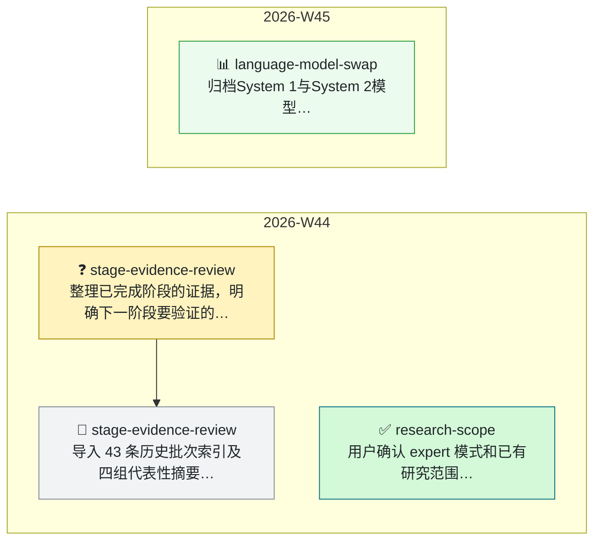

# 🧭 TIMELINE · 研发主线

> 本文件回答三个问题：**主线现在走到哪、怎么走到这里的、有没有在绕圈子。**
> 唯一写入口是 `python3 tools/timeline.py add`（AGENTS.md § 12），图由脚本生成，节点表只增不改。

- **当前主线一句话**：原阶段与两项模型替换补测已归档；较低候选生成Token未带来本轮得分提升，下一步明确反馈和执行契约。

---

## 1. 主线图（自动生成 · 勿手改）

<!-- TIMELINE:GRAPH:BEGIN -->

<!-- TIMELINE:GRAPH:END -->

**读法**：每个方框是一个 ISO 周，从左到右就是研发进度；粗箭头 `==>` 只连
`decision` / `pivot`——**它就是主线**，长时间不长一节 = 没有推进出结论；
细箭头是同一主题内的推进；虚线「重开」是已拍板的问题又被打开（绕圈的典型信号）。

---

## 2. 节点表（append-only）

<!-- TIMELINE:TABLE:BEGIN -->
| 节点 | 日期 | 类型 | 主题键 | 一句话 | 关联 | 上游 |
|---|---|---|---|---|---|---|
| `T-2026W44-001` | 2026-11-01 | question | stage-evidence-review | 整理已完成阶段的证据，明确下一阶段要验证的问题 | `DISC-2026W44-001` | - |
| `T-2026W44-002` | 2026-11-01 | decision | research-scope | 用户确认 expert 模式和已有研究范围，结果统一按实验室目录组织 | `DISC-2026W44-001` | - |
| `T-2026W44-003` | 2026-11-01 | note | stage-evidence-review | 导入 43 条历史批次索引及四组代表性摘要；本次新增实验为 0 | `DISC-2026W44-001` | - |
| `T-2026W45-001` | 2026-11-02 | experiment | language-model-swap | 归档System 1与System 2模型替换补测：输出缩短，但新候选未改善验证得分；历史与复用证据单列 | `EXP-2026W45-001`, `EXP-2026W45-002` | - |
<!-- TIMELINE:TABLE:END -->

---

## 3. 怎么写

```bash
python3 tools/timeline.py add --kind question --topic lr-schedule "学习率是不是瓶颈"
python3 tools/timeline.py check      # 绕圈检测
```

- **节点 ID**：`T-<年><周>-<序号>`（例：`T-2026W10-001`），由脚本按周分配。
- **类型**：`question` 提问 / `hypothesis` 假设 / `experiment` 改变判断的实验 /
  `decision` 拍板 / `pivot` 方向转弯 / `blocker` 卡住升级 / `note` 事后补充。
- **主题键 (topic)**：绕圈检测的钥匙——**同一件事必须共用同一个 topic**
  （例：`lr-schedule`、`pgd-robustness`）。短、稳定、可复用。
- **关联**：`EXP-...` / `DISC-...`（例：`DISC-2026W10-001`），逗号分隔；没有写 `-`。
- **上游**：父节点 ID（例：`T-2026W10-001`）；留 `-` 时自动接到同 topic 的上一个节点。
